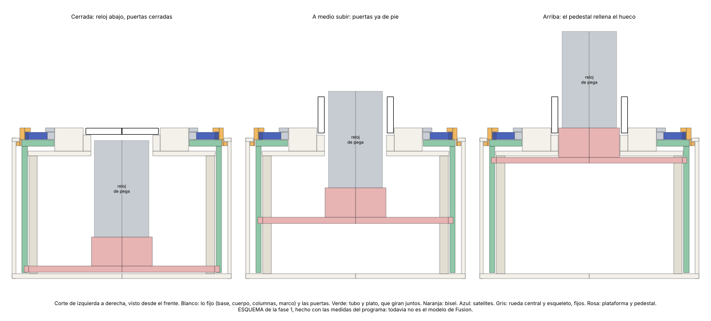

# La caja entera: antes de modelar

> **SUPERADA el 21-nov a las 18:02 por [`caja-entera.md`](caja-entera.md).** Se deja como estaba para que conste lo que se dijo antes de modelar. Tres cosas de esta nota no llegaron al modelo: la corredera recta (se metía en el hueco libre; ahora es un aro que gira 11°), las dos puertas distintas (ahora son la misma pieza, con la junta en bisel) y el tamaño (177 mm; el modelo mide 178,8).

Sesión del PC · 21 de noviembre de 2026, 15:40 · responde al apartado 11 de [BRIEF-v5.md](../BRIEF-v5.md), que pide decir primero lo que no se puede cumplir o tiene una forma mejor.

**Estado: empezado. Hecha la fase 1 (medidas y movimiento, calculados). En Fusion no hay todavía ninguna pieza de la caja.**

## 1. Lo que cambia respecto al brief

| Qué decía el brief | Qué sale | Por qué |
| --- | --- | --- |
| Caja de unos 150 mm de lado y 135 de alto | **177 mm de lado y 122 de alto.** Bisel de 164 mm | Dentro de la rueda central tienen que caber las puertas con sus bisagras y sus manivelas, y eso llega a 52 mm del centro. Con los 60 dientes del brief, la rueda mide 43 |
| Rueda central de 60 dientes, bisel de 84 | **78, 12 y 102 dientes**, módulo 1,5 | Lo mismo. El tubo gira 0,567 veces lo que el bisel (antes 0,58): 1,69 vueltas de bisel para todo el recorrido |
| Hueco de 50 × 59 | Hueco libre de 50 × 59, como pedía. **Lo que se ve de las puertas cerradas es un rectángulo de 58 × 73 mm** | Cada puerta sobra 7 mm por delante y por detrás del hueco: ahí apoya y ahí lleva la manivela |
| Las dos puertas, la misma pieza girada | **Dos piezas distintas**, una con labio y otra con rebaje | Con la raya recta y media madera, una puerta tiene que meter un labio bajo la otra. Si fueran iguales, la raya saldría en zigzag |
| Dos ranuras en espiral, una por puerta | **Una sola ranura y una sola corredera para las dos puertas** | Quita de raíz el cruce de pistas que avisaba el brief, y cabe: dos franjas no cabían |
| La pestaña es parte del tubo | **Tubo y plato son dos piezas** que encajan | Con la pestaña hacia dentro, el tubo no se puede meter por encima de las columnas |
| El cuerpo retiene el bisel | Igual, pero **el bisel entra en el cuerpo por debajo**, antes de montar el cuerpo | Así el labio del cuerpo es de una pieza y no hace falta nada encajado a presión arriba |

Con módulo 1,25 en vez de 1,5 la caja bajaría a unos 169 mm, con dientes un 17 % más finos. Lo dejo en 1,5, que es lo que pedía el brief.

## 2. Cómo se mueven las puertas

1. El **plato** (gira con el tubo) tiene por debajo una ranura en espiral. Es de radio constante, luego espiral, luego radio constante.
2. En la ranura entra el tetón de la **corredera**: una pieza plana, detrás de las puertas, que solo puede moverse de delante atrás. Recorre 10,9 mm.
3. La corredera tiene dos canales en diagonal, uno por puerta. En cada canal entra una **bola** que cuelga de la puerta, junto a la bisagra.
4. Al moverse la corredera, los canales empujan las bolas hacia dentro y las dos puertas giran 90° a la vez.
5. Cada canal empieza y acaba en un tramo recto, paralelo al movimiento. Con la bola ahí, empujar la puerta no mueve nada: **bloqueada por la forma**, cerrada y abierta.

Abrir y cerrar los hace el mismo canal, sin muelles, sin gravedad y sin imanes.

## 3. Lo comprobado en la fase 1

Calculado en plano, grado a grado de tubo, con `caja_diseno_v5.py`. Las 20 comprobaciones pasan: [`caja-fase1-comprobaciones.txt`](caja-fase1-comprobaciones.txt).

| Giro del tubo | Qué pasa |
| --- | --- |
| 0° a 45° | Nada. Tramo muerto |
| 45° a 105° | Se mueve la corredera. Las puertas giran entre los 66° y los 84° |
| 88° a 335° | Sube la plataforma, 88 mm |
| 335° a 345° | Rampa plana, arriba |

- El reloj de pega queda siempre a 3,2 mm o más de las puertas. El brief pide 3.
- Cerradas, las dos puertas tienen la cara de arriba en el mismo plano y ninguna línea recta cruza la junta.
- Abiertas, quedan a 90°, enteras fuera del hueco, y sobresalen 27,7 mm.
- Al abrir a la vez, el labio de una y el rebaje de la otra no se tocan (0,3 mm).
- Rampa: 14,8° de pendiente (el brief estimaba 18). Tres ranuras, con 5 mm de pared entre ellas en el peor punto.
- Con 0,20 mm de holgura, la puerta bloqueada baila 2,5° a cada lado. El brief admite de 85 a 95.
- Probado en Fusion: una ranura en hélice se hace con un barrido con giro y sale exacta. Era lo único que no sabía si se podía modelar.

**Nada de esto es «funciona».** Son cuentas de geometría: no hay ninguna fuerza.

## 4. Lo que queda por resolver al modelar

Ordenado de más a menos dudoso.

1. **Cómo se sujeta el marco a las tres columnas.** Pienso en tres uñas de presión. Es lo que aguanta todo boca abajo.
2. **Cómo se sujeta la placa de arriba (el esqueleto).** Pienso en la bayoneta de uñas del iris, con un retén para que no se afloje.
3. **Los pasadores de las bisagras:** 3 mm de diámetro, metidos desde fuera antes de montar la rueda central, que los tapa.
4. **El cuerpo a la base:** cuatro pestillos por dentro.
5. Que ninguna pieza se pueda montar del revés: columnas a ángulos desiguales y encajes que solo entran de una manera.

## 5. Lo que tiene que decidir Pepe

Nada bloquea. Sigo modelando con esto salvo que diga otra cosa:

1. **El tamaño: 177 × 177 × 122 mm**, sin la funda. El brief decía que no hacía falta que fuera pequeña.
2. **Lo que se ve arriba:** las dos puertas (58 × 73 mm, raya recta) dentro de un disco liso de 108 mm; alrededor, un aro fijo; después, la ventana de los engranajes y el bisel.

## 6. Lo siguiente

1. Fase 2: la forma de cada pieza en el programa, y el generador de Fusion.
2. Comprobaciones en el modelo, cada 2° de tubo.
3. El reporte, en `caja-entera.md`, y las probetas.
