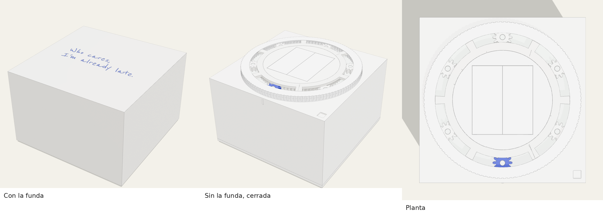
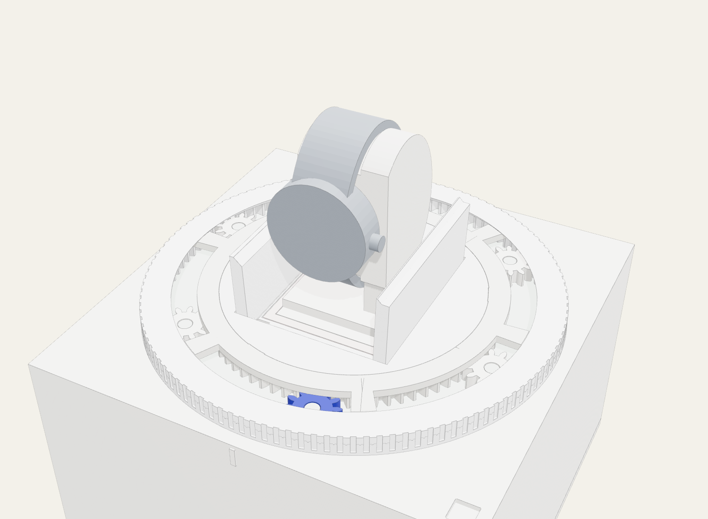
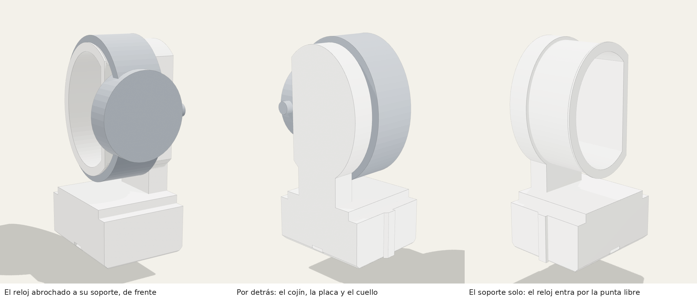
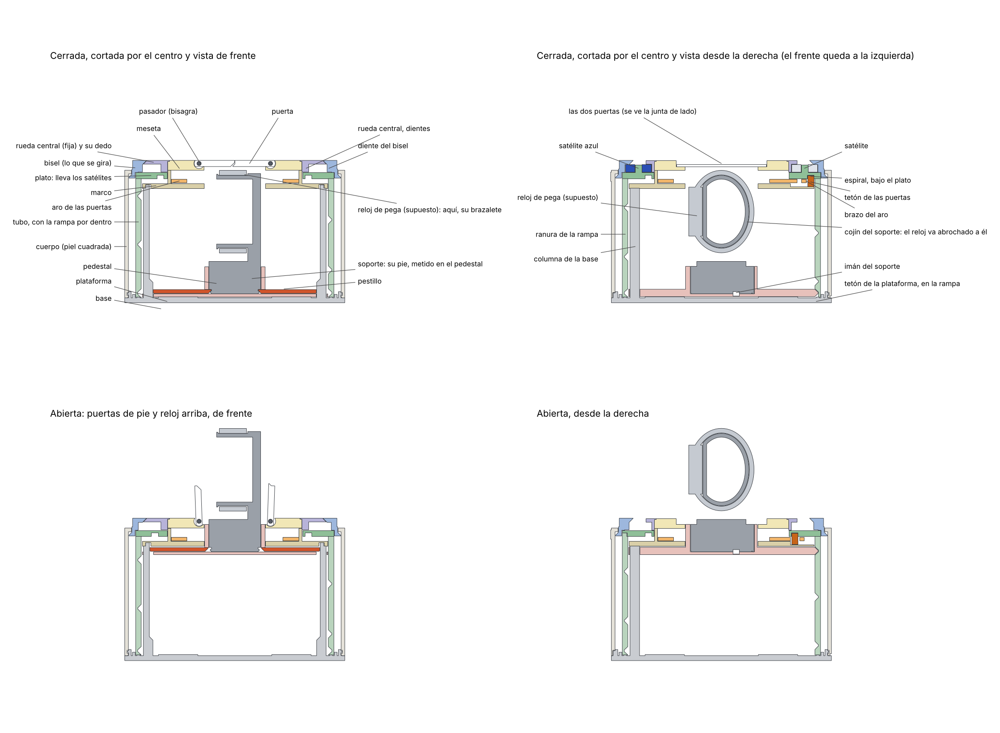
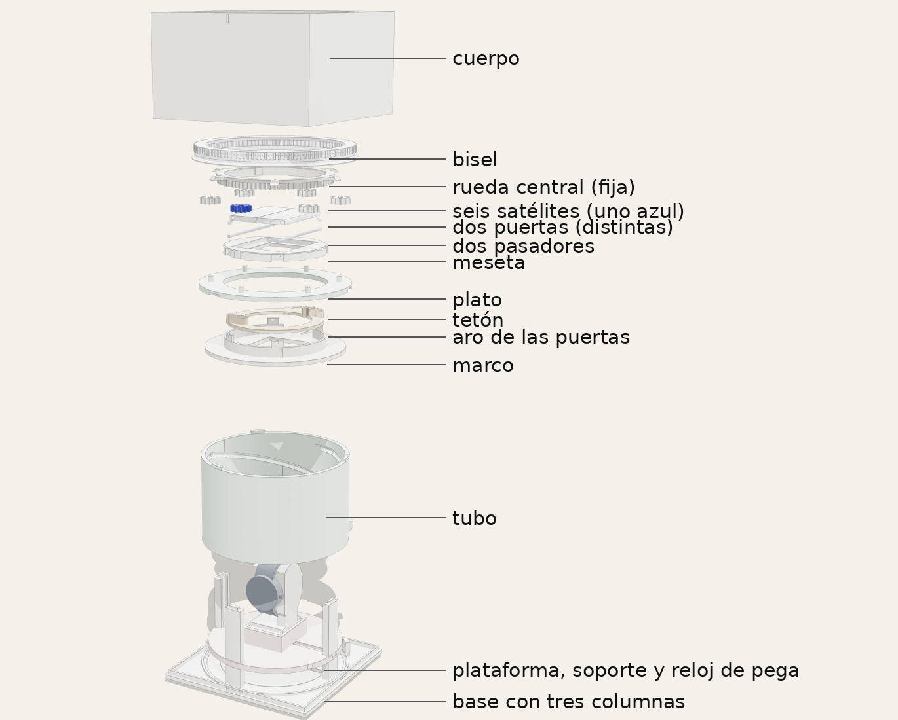
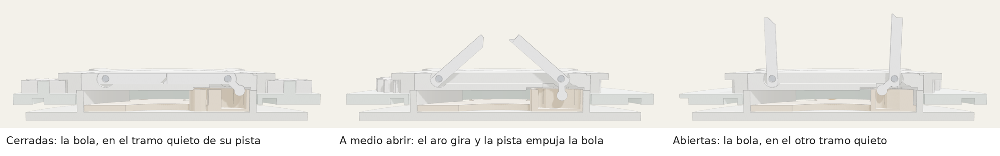
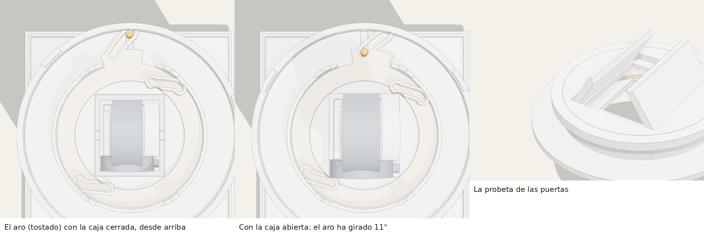
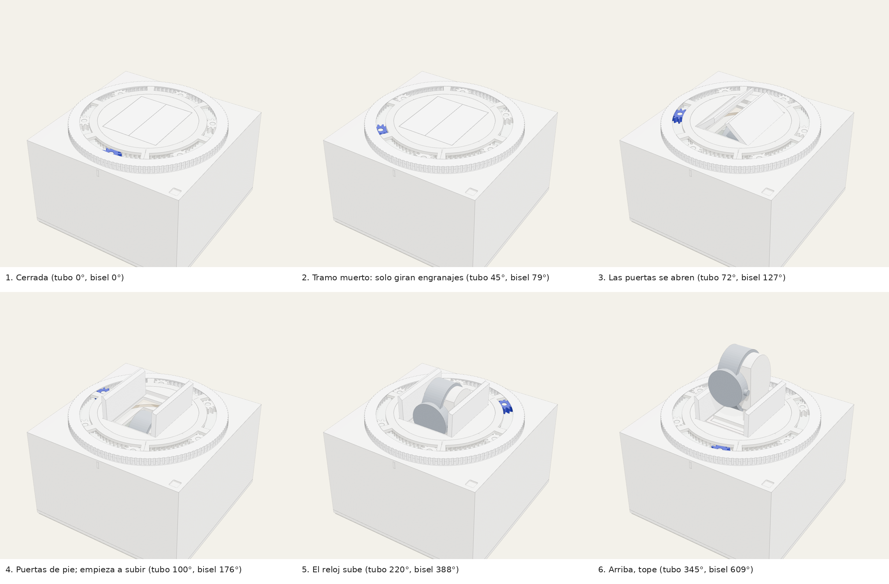

# Reporte: la caja v5 entera (puertas y ascensor)

Escrito el 21 de noviembre de 2026 por la sesión del PC. **Corregido el 24 de noviembre,** tras la revisión de la sesión del Mac ([`contra-reporte-caja.md`](contra-reporte-caja.md)): qué cambió, en el apartado 0.1. **Cambiado el 25 de noviembre:** por el encargo del apartado 13 del brief (D-34: suelo liso y soporte sujeto), apartado 0.2; y después, por el soporte nuevo (D-35) y una revisión entera del modelo (D-36), apartado 0.3. Responde a los encargos de los apartados 11 y 13 de [`../BRIEF-v5.md`](../BRIEF-v5.md).

**Nada de esto está impreso.** «Comprobado en el modelo» quiere decir que las piezas, dibujadas con sus holguras, se mueven como deben y no se pisan. No quiere decir que funcione: eso lo dirán las probetas. En este documento **no hay ninguna fuerza calculada** (tres previsiones de fuerzas ya las ha tumbado una pieza impresa).

Cada dato dice de dónde sale: **del modelo** (medido sobre las piezas dibujadas), **calculado** (cuenta hecha con medidas del modelo), **estimado**, **supuesto** (medida del reloj sin confirmar), **decidido** (lo eligió Pepe) o **medido** (sobre una pieza impresa).

## 0. En pocas líneas

- **Está modelada la caja entera: 25 piezas que se imprimen** (más la frase de la funda y el reloj de pega), en un programa de medidas y en Fusion. Las medidas del reloj van arriba de la lista, juntas.
- **Las puertas ya tienen cómo moverse**, que era lo que faltaba en el brief: un aro escondido alrededor del hueco gira 11° y mueve las dos a la vez. Lo abre y lo cierra la forma de las piezas, sin muelles, imanes ni gravedad.
- **En el modelo, de tope a tope y de 2 en 2 grados, ninguna pieza pisa a otra,** y el reloj de pega queda siempre a 3,00 mm o más de todo.
- **Mide 178,8 mm de lado y 115,7 de alto** (183,8 × 119,1 con la funda). De lado es más de lo que estimaba el brief (150). Ver el apartado 1.
- **Arriba, el reloj queda sobre un suelo liso, hundido 5 mm, y el soporte va sujeto por la forma mientras la caja está cerrada** (D-34, apartado 0.2). **Mira el dibujo del apartado 0.2: el aspecto es tuyo.**
- **El soporte es ahora uno corriente: un cojín ovalado al que el reloj va abrochado** (D-35, apartado 0.3).
- **He revisado el modelo entero** (D-36): montaje pieza a pieza, impresión capa a capa y holguras. Salieron fallos de verdad, ya corregidos (apartado 0.3). **En el modelo no queda ninguno conocido.**
- **Están los ficheros de imprimir de todas las piezas,** en doce bandejas, con su guía: [`../imprimir-v5/`](../imprimir-v5/LEEME.md).
- **Ocho cosas no cumplen el brief al pie de la letra o las he cambiado.** Están en el apartado 1. Ninguna espera una decisión tuya; una (si el soporte vuelca en la mesilla) espera al reloj de verdad.
- **Lo que sigue sin saberse** está en el apartado 6. Lo primero: las medidas del reloj son supuestas, y ninguna pieza de esta caja se ha impreso.
- **Propongo tres probetas** (puertas, ascensor y planetario) antes de la caja entera. Sus ficheros están en [`../probetas-v5/`](../probetas-v5/). Entre las tres son casi toda la caja: qué se imprime es una decisión tuya (apartado 9).

## 0.1 Qué cambió el 24 de noviembre

La sesión del Mac revisó el modelo y encontró 9 errores en las piezas, 1 en el programa y 6 en este reporte. Tenía razón. Su programa de comprobación, `calculos-mac/revisar_caja_v5.py`, daba 15 fallos; **el 24-nov quedó en 2, que eran decisiones tuyas.** Las dos se decidieron ese día (D-34) y están modeladas: apartado 0.2.

| Error | Qué pasaba | Qué he hecho |
| --- | --- | --- |
| E1 | Agujero de 0,3 × 1,2 mm en el centro de la raya | **Las dos puertas ya no son la misma pieza.** Una lleva la cuña a todo lo largo y la otra el hueco. Sin agujero |
| E2 | Los tetones de la plataforma, sin holgura en la rampa (0,02 mm) | La ranura se calcula ahora a través de la pendiente y con sus flancos curvos. Quedan 0,155 mm |
| E3 | Las puertas abiertas cedían hacia dentro hasta acercarse o tocar el reloj | Bisagras 1 mm más afuera, puerta abierta a 92° en vez de 90°, menos holgura en la bola (0,12) y en el aro (0,2). Empujada, cede hasta 87° y queda a 3,15 mm del reloj |
| E4 | Las puertas se rozaban al abrir y se pisaban si una se adelantaba | Con una cuña y un hueco enteros, y más hueco: lo más cerca, 0,31 mm; con 2° de adelanto no se pisan |
| E5 | El ala del bisel, una repisa en el aire | Es un cono a 45°: se imprime sin soportes |
| E6 | El aro: un extremo de cada pista en el aire y una pared de 0,3 mm | El anillo llega debajo de toda la pista; la pared mide 0,85 mm |
| E7 | La varilla tocaba el aro antes que la bola | Las paredes de la pista son 0,5 mm más bajas: ya no la toca |
| E8 | El cuerpo y la funda entraban girados | Cada uno tiene una llave escondida: girados no asientan |
| E9 | Zanjas delante y detrás del reloj cuando está arriba | Sin arreglar el 24-nov. **Resuelto el 25-nov** bajando el pedestal al nivel de las zanjas: apartado 0.2 |
| Programa | Con otro reloj, la segunda parte decía «todo bien» aunque la primera fallara | La segunda repite las comprobaciones de la primera. Columnas, asiento y ejes de los satélites salen ya de parámetros. La junta antigua, quitada |
| Reporte | Orden de montaje imposible, «todas sin soportes», cifras | Corregido en los apartados 3, 5, 7 y 9 |

También: el cuerpo tiene ahora una ranura detrás para sacarlo, y los ficheros de imprimir salen del programa, con las mallas cerradas.

**El vídeo `../video-v5/` es del modelo del 21 de noviembre.** El mecanismo es el mismo, pero ya no enseña dos cosas: el reloj acaba ahora 5 mm más bajo, y no salen el pie del soporte ni los pestillos. No lo he rehecho.

## 0.2 Qué cambió el 25 de noviembre por D-34: suelo liso y soporte sujeto

Quedaban dos cosas por decidir. Dijiste a la sesión del Mac: «decide tu las dos preguntas, pero que el reloj este seguro y se vea todo bien y premium». Las decidió (D-34) y me las encargó en el apartado 13 del brief. **Están modeladas.** Su programa de comprobación da **ningún fallo**. Nada está impreso.

**1. Suelo liso.** Arriba del todo, el pedestal ya no llega hasta la tapa: se queda 5 mm más abajo, a ras del asiento donde apoyan las puertas cerradas. Las zanjas de delante y detrás ya no son zanjas: son parte de ese suelo. El reloj queda en una bandeja hundida 5 mm, con una puerta a cada lado. De las dos maneras que daba el brief he hecho la que prefería: el ascensor sube 5 mm menos. Por eso la caja es 5 mm más baja (115,7) y la rampa, algo más tendida (13,9°).

**2. Soporte sujeto.** El soporte tiene un pie alto que entra en un cajeado del pedestal, y dos pestillos planos lo cogen por abajo. A los pestillos los mantienen metidos dos columnas de la base. Con la caja cerrada, el soporte con el reloj no se puede mover más de 0,3 mm en ninguna dirección. Sin imanes, sin muelles y sin nada que se doble. Cómo es, en el apartado 2.4.

**Lo que he hecho distinto de la propuesta de la sesión del Mac,** y por qué:

| Qué | Por qué |
| --- | --- |
| Dos de las tres columnas de la base han cambiado de sitio: ahora están a derecha e izquierda (0° y 180°; la tercera sigue en 262°) | Para que cada pestillo vaya recto hacia su columna. Siguen siendo desiguales: nada entra girado |
| El pie del soporte mide 42 × 50 mm (la peana de antes, 34 × 40) | Con el pie alto, el reloj queda 22 mm más arriba en la mesilla y vuelca antes. Con el pie ancho recupera el margen (fila 8 del apartado 1). El brief lo permitía |
| Los pestillos tienen un tope hacia dentro | Sin él, con la caja cerrada y sin soporte, un pestillo podía meterse en el cajeado vacío al mover la caja, y luego el soporte no asentaba |
| **Los pestillos solo sujetan con la plataforma abajo** (los primeros 9 mm de subida). De 12 mm para arriba el soporte está libre. El encargo decía «sujeto mientras la caja no esté abierta del todo» | Hace falta sujetarlo con la caja cerrada, que es cuando viaja. Y sujetarlo también a medio abrir tenía una trampa: quien pusiera el soporte sin haber abierto hasta el tope lo dejaba apoyado encima de los pestillos, 3,1 mm alto y sin sujetar, y al cerrar las puertas quedaban justo sobre el reloj (0,0 mm en el modelo). Así, con la caja abierta, el soporte siempre entra y siempre sale |

**Lo que queda de los dos problemas** (sin adornar):

- **Las dos ventanas de las manivelas siguen viéndose** en el suelo, pegadas a las puertas, en dos esquinas (8,6 × 5,7 mm cada una). No las he achicado.
- **Alrededor del soporte se ven dos líneas:** la del cajeado de su pie (0,3 mm) y el escalón de su zócalo, que asoma 4 mm.
- **Con la caja abierta y boca abajo, el soporte se sale.** Abierta está libre a propósito.
- **El suelo hundido es una decisión de aspecto tomada sobre un dibujo.** Si no te gusta al verlo, se vuelve atrás: es solo la altura del pedestal.

## 0.3 Qué cambió después, el mismo 25 de noviembre: soporte normal (D-35) y revisión entera (D-36)

**El soporte.** Dijiste: «El soporte del reloj es raro, haz un soporte normal en el que vaya abrochado y ya». Lo de arriba del soporte (un travesaño entre dos mejillas) ha desaparecido. Ahora es **un cojín ovalado que llena el brazalete cerrado: el reloj se abrocha a él.** El pie y los pestillos de debajo siguen igual.

Tres cosas de este soporte que conviene saber:

- **El cojín va cogido solo por un lado** (una placa a la derecha) y tiene la otra punta libre. Es así porque un brazalete de metal con cierre de pliegue no se abre del todo: es un lazo, y hay que meterlo por una punta, como en la muñeca. El soporte de antes, cerrado por los dos lados, no dejaba poner el reloj. Era un fallo mío.
- **El cojín está hecho a la medida del brazalete cerrado, que es supuesta** (67 × 53 mm por fuera). Si el brazalete se acorta o se alarga un eslabón, el cojín hay que rehacerlo: son dos números. Con el brazalete más largo que el cojín, el reloj cuelga y baila.
- **Se imprime tumbado sobre su costado,** para que el cojín salga sin soportes.

**La revisión.** Dijiste: «Revisa tu trabajo, comprueba que todo esté en su sitio que todos los mecanismos funcionen bien y que todas las piezas tengan su funcion y esten lo mas optimizadas posibles, no dejes de trabajar hasta que hayas refinado una version que tenga 0 errores y que se pueda imprimir como versión final…». He escrito un programa de auditoría, [`../caja_auditoria_v5.py`](../caja_auditoria_v5.py), que hace tres cosas que no hacía nadie: **monta la caja pieza a pieza** por su camino de entrada, **mira cada pieza capa a capa** tal como se imprime, y **mide lo cerca que pasan** las piezas que se mueven. Resultado en [`caja-auditoria.txt`](caja-auditoria.txt). Lo que encontró y lo que he hecho:

| Qué encontró | Gravedad | Qué he hecho |
| --- | --- | --- |
| **Los pestillos del soporte no se podían montar:** su canal acababa a 0,75 mm del borde del disco y no había por dónde meterlos | Fallo mío, de esta mañana. La caja no se habría podido montar | El canal sale ahora hasta el borde |
| El pestillo, al salir, tenía 0,05 mm a cada lado en el rebaje de la columna, y sus esquinas quedaban a 0,09 mm de ella | Se habría atascado | Rebaje 1,6 mm más ancho; punta del pestillo en arco, a 0,25 mm de la columna en todo el ancho |
| **Lo que sujetaba el soporte era un labio en filo,** de 0,2 a 0,5 mm de grueso, y bastaba retirar el pestillo 0,9 mm para soltarlo. Lo vi al trazar, paso a paso, cómo el soporte aparta los pestillos | Es lo único que retiene el reloj boca abajo: demasiado poco | Nariz del pestillo plana por arriba y a 45° por abajo; debajo, el pie tiene un hombro macizo. Agarra 0,88 mm con la caja cerrada. Y la comprobación nueva queda en el programa |
| **Los dientes engranaban con 0,08 mm entre flancos.** La holgura medida en las probetas para lo que desliza es 0,20 | Con 12 engranes a la vez, habría ido duro o no habría girado. Ya lo avisó la sesión del Mac | Ahora quedan de 0,16 a 0,19 mm (`juego_dientes`, de 0,2 a 0,4). La punta del diente más fino mide 0,72 mm |
| En el tubo, al final de cada ranura, un techo plano de 2,5 mm al aire, justo donde descansa el tetón arriba | Al imprimirse se descuelga y podía rozar al llegar al tope | Relleno: el techo sigue a 45° |
| Las cuatro pestañas que sujetan el cuerpo a la base eran escalones rectos | El canto del cuerpo tropezaba en plano; y se imprimían con 1 mm al aire | Son cuñas a 45° por arriba y por abajo, y el canto del cuerpo lleva chaflán: entra resbalando y hace clic |
| Los pasadores de las bisagras, redondos, tumbados en la cama | Se despegan o salen deformados | Una cara plana de 1,5 mm, que al montar va hacia abajo |
| En la meseta, el techo sobre los cuernos del aro dejaba 0,6 mm | Ese techo se imprime en puente y puede descolgarse | 1,0 mm |
| En las dos columnas de los pestillos, una repisa de 0,9 mm bajo la espiga | Menor | Quitada |
| En los ficheros de imprimir, mallas con triángulos de área cero (648 en el bisel) y, en la base, el tubo y la plataforma, rebabas de una centésima | Un laminador puede avisar de «malla abierta». El 24-nov escribí que todas eran cerradas: lo eran al escribirlas, no al volver a abrirlas | Rebabas quitadas del modelo y mallas limpiadas al escribirlas. **Los 51 cuerpos de los 22 ficheros se han vuelto a abrir uno a uno:** todos cerrados |
| Mi comprobación de «puerta abierta» daba por bueno 96,2° contra un límite de 95° | Mi programa medía mal (un paso tarde) | Corregido: da 89,75° a 94,50°, igual que el de la sesión del Mac |

**Lo que la auditoría da ahora:** los 20 pasos de montaje, sin pisar nada; ninguna pieza con islas ni voladizos, solo puentes de hasta 16 mm; y cuatro avisos que son a propósito (dos paredes de 0,7 mm junto a los imanes del tope, la arista del hombro del soporte y los trazos de la frase, de 0,8 a 1,0 mm).

**Lo que la revisión no puede dar.** «0 errores» quiere decir que en el modelo no queda ninguno conocido. No quiere decir que la caja funcione: **ninguna de sus piezas se ha impreso.** Y no es todavía una versión final, por una sola razón: **las medidas del reloj son supuestas.** El día que las tenga se cambian arriba de `../caja_diseno_v5.py` y se regenera todo, ficheros de imprimir incluidos.

## 1. Lo que no cumple, o cambia, respecto al brief

Lo primero y sin adornar.

| # | Qué pedía el brief | Qué hay en el modelo | Por qué |
| --- | --- | --- | --- |
| 1 | Caja de unos 150 mm de lado y 135 de alto (estimado a mano) | **178,8 de lado y 115,7 de alto** (del modelo). Con funda, 183,8 × 119,1 | Alrededor del hueco de 50 × 59 van, uno dentro de otro: la meseta con las bisagras, la rueda central, los satélites, el bisel y la pared. La cuenta a mano del brief no contaba el sitio de las bisagras ni el del aro que mueve las puertas |
| 2 | Puertas cerradas: escalón de 0,3 mm o menos | **Cumple con la caja de pie** (apoyan en su asiento, a ras). **Boca abajo no:** cada puerta se puede descolgar hasta 2,5° (1,3 mm en la punta) antes de que la pare su pista (del modelo) | La bola que mueve cada puerta va en su pista con 0,12 mm de holgura por lado, y el brazo de la bola solo mide 8 mm: poca holgura ahí es mucho ángulo en la puerta. Se ajusta con la probeta (apartado 9) |
| 3 | Nueve imanes, tres en el final de recorrido | **Diez imanes,** cuatro en el final de recorrido (dos en la oreja del tubo y dos en el tope) | Con tres, uno tendría que servir para los dos extremos y quedaría a 4 mm de su pareja: no haría nada. Quedan 3 de repuesto de los 13 |
| 4 | Mejor nada pegado | **Los imanes de la funda y del soporte van en cajeras abiertas:** o entran a presión, o llevan un punto de pegamento. Los cuatro del tope entran de canto en una ranura y no se pueden caer con la caja boca abajo | No sé si un alojamiento de 5,20 sujeta el imán o solo lo deja entrar: la P0 dijo que «entra». Es adorno: sin imanes la caja funciona igual |
| 5 | Soporte del reloj: pinza en C y peana, como en la v4 | **Un cojín ovalado al que el reloj va abrochado, sobre un pie que entra en el pedestal** (D-35, apartado 0.3). De una pieza, sin pinza | Lo pediste así («un soporte normal en el que vaya abrochado»). El cojín sale de las medidas del brazalete, que son supuestas |
| 6 | Arriba, el pedestal rellena el hueco y queda a ras de la tapa | **Cambiado por D-34: queda a ras del asiento de las puertas, 5 mm por debajo de la tapa** (escalón de 0,00 en el modelo). Rendija de 0,4 mm al marco. A cada lado, 1,9 mm hasta la puerta abierta, con el suelo a la misma altura. Quedan a la vista las dos ventanas de las manivelas | Las zanjas eran el asiento de las puertas y no se pueden quitar; se ha bajado el pedestal a su altura. **Decidido** (D-34). Mira el dibujo del apartado 0.2 |
| 7 | Boca abajo no se cae nada | **Cumple con la caja cerrada:** el soporte con el reloj no se mueve más de 0,3 mm, y el reloj, abrochado al cojín, 0,5 mm. **Con la caja abierta, boca abajo el soporte se sale** | Abierta tiene que estar libre para cogerlo sin soltar nada. **Decidido** (D-34) |
| 8 | En la mesilla, el soporte con el reloj se tiene de pie y no vuelca con un toque (apartado 13.2) | **Sin demostrar.** Calculado: vuelca si se inclina entre 17° y 21° hacia delante, unos 20° a los lados y unos 30° hacia atrás | Sale de un reloj supuesto de 150 g que pesa más por delante, y del soporte entre hueco (36 g) y macizo (104 g). Propongo imprimirlo macizo. Lo dirá el reloj de verdad sobre el soporte impreso |

Y tres cosas que no son incumplimientos pero conviene que sepas:

- **La tarjeta no está modelada.** El brief la deja «en la funda, o fuera de la caja»: no tiene sitio todavía.
- **La frase está puesta en el techo de la funda,** de 118 mm de ancho. Ahí sale gratis: la funda se imprime boca abajo y la frase son sus tres primeras capas, en azul. Dónde va es tuyo (apartado 8).
- **La meseta (el marco liso que rodea las puertas) sale con otro acabado que las puertas.** Las puertas, la rueda central y el bisel se imprimen con la cara vista contra la cama; la meseta no puede (necesitaría soportes), así que su cara vista es la de arriba de la impresión. Puede notarse el brillo distinto. Ver el apartado 6.

## 2. Qué es y cómo funciona

### 2.1 De fuera adentro

- **Cuerpo:** la piel cuadrada. Lleva el índice del frente, en relieve. Entra a presión en la base con cuatro pestañas.
- **Bisel:** lo que se gira. Estriado por fuera y dentado por dentro (102 dientes). Asoma 8 mm sobre el cuerpo. No se puede sacar hacia arriba: un ala suya queda debajo del labio del cuerpo.
- **Satélites:** seis ruedas de 12 dientes, una azul. Ruedan entre el bisel y la rueda central, y al rodar dan vueltas alrededor del hueco.
- **Rueda central:** fija, 78 dientes. Por arriba es una placa lisa con seis dedos que tapan a medias los satélites: son los «puentes» del esqueleto.
- **Plato y tubo:** el plato lleva los ejes de los satélites y va encajado en lo alto del tubo. Giran juntos, a 0,567 veces lo que gira el bisel (calculado: 102 / 180).
- **Tubo:** por dentro lleva tres ranuras en espiral, como un pintalabios. En ellas van los tres tetones de la plataforma.
- **Plataforma con pedestal:** sube recta porque tres muescas suyas corren por las tres columnas de la base. Abajo del todo descansa en un asiento de la base, no colgada de sus tetones. Arriba del todo, el pedestal queda a ras del asiento de las puertas, 5 mm por debajo de la tapa.
- **Soporte y pestillos:** el reloj va abrochado a un cojín ovalado. El pie del soporte entra en un cajeado del pedestal, y dos pestillos lo cogen con la caja cerrada. Apartado 2.4.
- **Marco y meseta:** lo fijo de arriba. El marco apoya en las tres columnas; la meseta va encima, lleva las bisagras y es lo liso que se ve alrededor de las puertas.
- **Puertas:** dos, de 5 mm. Son dos piezas distintas: una lleva la cuña de la junta y la otra, el hueco. Cada una gira en un pasador de 3 mm.
- **Aro de las puertas y tetón:** lo que las mueve. Apartado siguiente.
- **Funda:** campana cuadrada. Solo entra con su frente al frente (lleva un canal para el índice del cuerpo).

### 2.2 Cómo se mueven las puertas (lo que faltaba en el brief)

El brief proponía dos correderas con dos ranuras en espiral en el plato, y avisaba de que no sabía si cabían. Las dibujé: una corredera recta, al abrirse, se metía dentro del hueco libre de 50 × 59. Tampoco cabían dos franjas de espiral. Lo que hay es la tercera idea del brief (un aro intermedio que gira poco), resuelta así:

1. **Cada puerta lleva por debajo una varilla corta con una bola en la punta** (una manivela de 8 mm).
2. **Alrededor del hueco, escondido bajo la meseta, hay un aro** con dos pistas, una para cada bola. Cuando el aro gira 11°, las pistas empujan las bolas y las puertas giran 90°. Los dos extremos de cada pista son tramos «quietos» (arcos con centro en el eje de la caja): ahí el aro puede moverse un poco sin que la puerta se entere, y la puerta no puede moverse porque la bola está entre dos paredes. **Eso es lo que las bloquea abiertas y cerradas.**
3. **El aro lo mueve el plato con un tetón suelto** (un cilindro de 5 × 9 mm). El tetón está a la vez en tres ranuras: una espiral en la cara de abajo del plato, una ranura recta en el marco (solo le deja ir hacia dentro o hacia fuera) y una ranura en diagonal en un brazo del aro. Cuando el plato gira, la espiral mete el tetón 13 mm hacia dentro, y el tetón, al entrar, empuja la diagonal y gira el aro.

Así hay **una sola espiral** y no hay cruce de pistas: la trampa que avisaba el brief no puede darse.

**La junta del centro** es en bisel, a 45°: una puerta lleva una cuña a todo lo largo, que se mete 1,4 mm bajo la otra, y la otra lleva el hueco. Mirando desde arriba por la raya (0,3 mm) solo se ve puerta, sin agujero. Es en cuña, y no en escalón, para que las puertas se impriman con la cara vista contra la cama y sin soportes. El canto de la puerta del hueco se queda en 1,7 mm. Si al montar se cambian de lado, funciona igual.

### 2.3 El recorrido

| Giro del tubo | Giro del bisel | Qué pasa |
| --- | --- | --- |
| 0° a 45° | 0° a 79° | Tramo muerto: giran el bisel y los engranajes, nada más |
| 45° a 63° | 79° a 111° | El tetón empieza a entrar y el aro a girar, pero las bolas están en su tramo quieto: las puertas siguen cerradas |
| 63° a 83° | 111° a 146° | Las puertas se abren |
| 83° a 92° | 146° a 162° | Puertas ya de pie; el aro termina su giro y las deja bloqueadas |
| 92° a 335° | 162° a 591° | El reloj sube 81,1 mm |
| 92° a 119° | 162° a 209° | Dentro de lo anterior, los primeros 9 mm de subida: los pestillos siguen sujetando el soporte. De 12 mm para arriba (128° de tubo) está libre |
| 335° a 345° | 591° a 609° | Rampa plana y tope: el reloj descansa arriba |

Todo el recorrido son **609° de bisel: una vuelta y dos tercios** (calculado). Se abre girando en el sentido de las agujas del reloj, visto desde arriba. Las puertas terminan de abrirse 9° de tubo antes de que el reloj empiece a subir.

### 2.4 El soporte: cómo lleva el reloj y cómo se sujeta (D-34 y D-35)

Se ve en los dos cortes de frente del apartado 2 (el soporte en gris oscuro, los pestillos en rojo) y en el dibujo del apartado 0.3.

**Cómo lleva el reloj:**

1. **Un cojín ovalado, hueco, de 37 × 59 mm y 24 de largo,** que llena el brazalete cerrado con 0,4 mm de holgura. Por delante es plano: ahí apoya la tapa trasera del reloj.
2. **El cojín va en voladizo desde una placa,** a la derecha. Por la izquierda tiene la punta libre, con un reborde de 1 mm. El reloj se mete por esa punta con el cierre abierto, y al cerrarlo queda abrochado: el reborde y la placa no le dejan salirse de lado.
3. **Un cuello une la placa al zócalo.** El brazalete pasa por debajo del cojín sin tocar nada.

**Cómo se sujeta a la caja:**

1. **El soporte tiene un pie de 42 × 50 mm y 22 mm de alto** que entra en un cajeado del pedestal, hasta dentro del disco de la plataforma. Dentro no puede volcar ni correrse (0,3 mm de holgura por lado). Una llave detrás hace que solo entre mirando al frente. Por encima del pedestal asoma un zócalo de 4 mm.
2. **Dos pestillos planos** (47 × 9,5 × 3 mm), uno a la derecha y otro a la izquierda, van en canales del disco. Los canales son en cola de milano: boca abajo no se salen. La punta de dentro de cada pestillo es una cuña, plana por arriba y a 45° por abajo, que entra 2 mm en una muesca del pie del soporte, por encima de un hombro macizo: eso es lo que lo sujeta. Para soltarlo, el pestillo tendría que retirarse 1,12 mm, y con la caja cerrada la columna solo le deja 0,25. La punta de fuera queda a 0,25 mm de la cara de dentro de una columna de la base.
3. **Con la plataforma abajo, la columna es una pared lisa:** el pestillo no puede salir y el soporte no se puede levantar.
4. **De 12 mm de subida para arriba, la columna tiene un rebaje de 2,9 mm.** Ahí el pestillo queda libre. Al tirar del soporte hacia arriba, el hombro, que también va a 45°, aparta los dos pestillos. Al volver a meterlo, los aparta el chaflán de abajo del pie.
5. **Al cerrar,** cuando a la plataforma le quedan entre 12 y 9 mm para llegar abajo, una rampa a 45° al pie del rebaje vuelve a meter cada pestillo.
6. **Un tope en el disco** impide que un pestillo se meta en el cajeado cuando no hay soporte.

Qué pasa si algo se hace mal:

| Si... | Qué pasa | De dónde sale |
| --- | --- | --- |
| Se cierra sin el soporte | Nada. Los pestillos entran en vacío y hacen tope | Del modelo |
| El soporte se pone girado media vuelta | No entra en el cajeado: se queda encima, torcido. Se ve | Del modelo |
| El soporte se pone sin haber abierto hasta el tope | Entra igual: los pestillos están libres en cuanto la plataforma ha subido 12 mm | Del modelo |
| El soporte queda algo levantado (hasta 1,4 mm) cuando la rampa mete los pestillos, por una mota o porque no asentó | La cuña del pestillo entra por encima del hombro y baja el soporte a su sitio | Del modelo, paso a paso. Con roce de verdad, sin probar |
| **El soporte se queda atascado a medio entrar,** 1,6 mm alto o más | **Lo peor que queda.** Los pestillos lo empujan hacia arriba y se meten debajo: el soporte queda 2,8 mm alto y sin sujetar, y al cerrar al reloj le quedan 0,3 mm hasta las puertas. No hay aviso. Para que no pase, el cajeado tiene 0,3 mm de holgura por lado y el pie lleva chaflán por abajo: **el soporte tiene que bajar hasta el fondo por su propio peso.** Es una de las pruebas de la probeta del ascensor | La altura y la distancia, del modelo. Que baje por su peso, sin probar |
| El brazalete es más largo que el cojín | El reloj cuelga del cojín y baila. Con la caja cerrada puede tocar las puertas: **el cojín tiene que hacerse a la medida del brazalete** | Razonado. Depende del reloj |
| Se quitan los imanes | Igual. El imán del soporte es solo para el «clac» | Del modelo |

## 3. Medidas

Todas del modelo, salvo donde se dice.

| Qué | Valor |
| --- | --- |
| Caja sin funda | 178,8 × 178,8 × 115,7 mm |
| Con la funda | 183,8 × 183,8 × 119,1 mm |
| Abierta, con las puertas de pie | sobresalen 28,1 mm la de la cuña y 26,3 la otra; el reloj de pega, 73 mm |
| Bisel | 167,2 mm de diámetro donde se agarra; asoma 8 mm; 120 estrías |
| Hueco de las puertas | 50 × 59 mm, libre del todo con las puertas abiertas |
| Puertas | 5 mm de grueso; raya del centro, 0,3 mm; holgura de la bisagra, 0,25 por lado; abiertas, a 92° |
| Recorrido del ascensor | 81,1 mm |
| Pendiente de la rampa | 13,9° donde apoyan los tetones (el brief estimaba 18°) |
| Lo que sube por vuelta de bisel | 68,1 mm (calculado) |
| Pedestal arriba | a ras del asiento de las puertas, 5 mm bajo la tapa (escalón, 0,00); 0,4 mm hasta el marco; 1,9 mm hasta cada puerta abierta |
| Huecos en el suelo, alrededor del reloj arriba | 283 mm² entre rendijas, las dos ventanas de las manivelas y la línea del cajeado (medido con el programa de la revisión; antes, a ras de la tapa, 1.062) |
| Soporte | pie de 42 × 50 mm (51,5 con la llave) y 22,3 de alto, dentro del pedestal; zócalo de 42 × 40, que asoma 4 mm; cojín de 37 × 59 mm y 24 de largo, con pared de 3 mm; en total, 97,7 de alto |
| Pestillos | 47,2 × 9,5 × 3,0 mm; salen 2,7 mm; sujetan con la plataforma en sus primeros 9 mm de subida y están libres de 12 mm para arriba |
| El reloj en la mesilla, sobre su soporte | lo más bajo del reloj, a 33 mm de la mesa; lo más alto, a 100 (supuesto: depende del reloj) |
| Engranajes | módulo 1,5; central 78 dientes, satélites 12, bisel 102; 6 mm de grueso |
| Juego entre dientes | 0,4 mm quitados entre los dos dientes que engranan (parámetro `juego_dientes`): quedan de 0,16 a 0,19 mm entre flancos (del modelo). Antes, 0,2 y 0,08 |
| Diente más fino | la punta del diente de los satélites: 0,72 mm. A media altura, 2,16 mm |
| Reloj de pega a lo más cercano | 3,00 mm de la meseta y del marco; 3,10 de las puertas cerradas, que le quedan encima; 6 o más de la rueda central |
| Volumen de plástico si todo fuera macizo | 1.335 cm³ (unos 1,65 kg). Con relleno normal será bastante menos: **no está laminado, no lo sé** |

**Juego de la plataforma.** Va colgada de tres tetones en cono dentro de tres ranuras en V, que la centran por su peso. En la rampa, entre cada tetón y su ranura quedan 0,154 mm (medido con el programa de la revisión; el diseño pide 0,20 y el 21-nov, por un error mío, quedaban 0,02). En las columnas tiene 0,35 mm por lado: puede girar 0,29° a cada lado (calculado).

**Las medidas del reloj son todas supuestas** (cabeza 40 mm, 43,5 con corona, 11 de grueso; brazalete cerrado 67 × 53; alto en su soporte 78). Están arriba del todo en [`../caja_diseno_v5.py`](../caja_diseno_v5.py). El día que lo midas, se cambian ahí y se regenera todo.

## 4. Qué se ha comprobado y con qué

### 4.1 Con el programa, de 2 en 2 grados

[`../caja_piezas_v5.py`](../caja_piezas_v5.py) construye las 27 piezas en 3D, las coloca en 174 posiciones (de 0° a 345° de tubo, de 2 en 2) y calcula el volumen que comparte cada pareja de piezas. El resultado completo está en [`caja-fase2-comprobaciones.txt`](caja-fase2-comprobaciones.txt). No hay «ida y vuelta» distintas: en el modelo cada posición del bisel tiene una sola posición de todo lo demás, así que cerrar es pasar por las mismas 174 posiciones al revés.

| Qué | Resultado |
| --- | --- |
| Ninguna pieza pisa a otra | **Bien.** Ninguna pareja comparte más de 0,02 mm³ en ninguna posición |
| El reloj, a 3 mm o más de puertas, marco, meseta y rueda central | **Bien.** Mínimo, 3,00 mm |
| El tubo gira lo que le toca y los satélites orbitan | **Bien** por construcción (las piezas se colocan con la relación 0,567) y porque así colocadas los dientes no se pisan en ninguna posición |
| Puertas cerradas, bloqueadas | **Bien, con juego.** Con el aro quieto, una puerta se deja levantar 2,5° y ahí choca con su pista |
| Puertas abiertas, bloqueadas | **Bien, con juego.** Con el aro en su sitio, cada puerta se deja mover entre 89,75° y 94,5° (el brief pide entre 85° y 95°; mi programa y el de la revisión dan ya lo mismo). Con el aro corrido 0,15 mm, cede hacia dentro hasta 87,0°, y ahí queda a 3,15 mm del reloj y entra 0,10 mm en el hueco libre (cifras del programa de la revisión) |
| Las puertas se pueden montar | **Bien.** Cada una entra de pie, desde arriba, con el aro en «abierto», sin pisar nada |
| El tetón va guiado | **Bien.** Moverlo 1,2 mm fuera de cualquiera de sus tres ranuras choca |
| La plataforma va guiada | **Bien.** No se deja subir, bajar ni girar por su cuenta |
| La plataforma no se hunde | **Bien.** Abajo apoya en su asiento (a 0,15 mm); en la rampa y arriba, bajarla 0,6 mm choca. Esto lo encontré tarde: sin el asiento, con la caja cerrada la plataforma bajaba 1 mm y al empezar a girar tenía que subir un escalón |
| Los dientes engranan | **Bien.** Girar un satélite medio diente lo mete en la rueda central y en el bisel |
| Topes | **Bien.** 2° más allá de cerrado o de abierto, la oreja del tubo choca con el tope de la base |
| Boca abajo no se cae nada de lo que va montado | **Bien** (el soporte: filas de abajo y fila 7 del apartado 1). Cada pieza, al moverla 1,5 mm hacia la tapa, choca con la que la sujeta. Lo que se descuelga: el bisel 0,8 mm, la rueda central 0,2 más, y las puertas lo dicho en el apartado 1 |
| Los pasadores no se salen | **Bien.** La rueda central les tapa las dos puntas |
| La funda | **Bien.** Puesta, no pisa nada y queda a 0,5 mm por lado |
| A ras | **Bien.** Puertas, meseta, placa de la rueda central y bisel, en un mismo plano. El pedestal, arriba, a ras del asiento de las puertas (5 mm más abajo) |
| El soporte, sujeto con la caja cerrada | **Bien.** Con el reloj puesto, se deja mover 0,2 mm hacia arriba, 0,2 a derecha e izquierda, 0,3 hacia delante y hacia atrás, y nada hacia abajo (el brief pide 1 mm o menos) |
| El soporte, sujeto solo abajo | **Bien.** Con la plataforma a 8 mm del suelo, solo se deja levantar 0,2 mm |
| El soporte, libre con la caja abierta | **Bien.** Abierta del todo, a media altura y con la plataforma a 12 mm del suelo, sale tirando 40 mm hacia arriba sin pisar nada. **Comprobado con los pestillos ya apartados:** que los aparte el propio soporte al tirar lo dirá la probeta |
| El soporte no entra girado | **Bien.** Girado media vuelta, pisa el pedestal |
| Los pestillos van guiados | **Bien.** No se dejan sacar (los para la columna), levantar (la cola de milano) ni correr de lado (el canal). En el tramo libre, metidos o salidos, no pisan nada |
| Sin el soporte puesto | **Bien.** Los pestillos hacen tope a 0,2 mm y no se meten en el cajeado vacío |
| El soporte aparta él solo los pestillos | **Bien, en el dibujo.** Paso a paso (cada 0,05 mm), al sacar el soporte y al meterlo hay siempre un camino sin choques en el que el pestillo solo va hacia fuera, 1,12 mm, y nunca a más de 45°. **Que con el roce de verdad resbale lo dirá la probeta** |
| El reloj, abrochado al cojín | **Bien.** No pisa el soporte y solo se deja mover 0,4 mm hacia arriba, hacia abajo y hacia delante, 0,5 hacia atrás, 1,2 a la derecha y 0,6 a la izquierda. **En el modelo el brazalete es rígido y de la medida supuesta** |

### 4.2 En Fusion

[`../generador_caja_v5.py`](../generador_caja_v5.py) repite en Fusion, una a una, las mismas operaciones con que el programa hace cada pieza. Hecho de nuevo el 25 de noviembre con el modelo revisado. El resultado está en [`caja-fusion-comprobaciones.txt`](caja-fusion-comprobaciones.txt) y el modelo, en `../Eventually-caja-v5.f3d`.

| Qué | Resultado |
| --- | --- |
| Las piezas de Fusion son las del programa | **Bien.** Las 29 (27 de la caja y 2 de probeta) tienen el mismo volumen; la que más se aparta, 0,29 % (el programa redondea los cilindros). Fusion las construyó todas a la primera, sin tener que retocar ninguna operación |
| Recorrido completo en Fusion: 174 posiciones, de 2 en 2 grados | **Bien. Ninguna pareja se pisa.** Una vuelta completa, de una vez, con todas las piezas contra todas (46 minutos). Después de esa vuelta cambié tres piezas, el soporte y los dos pestillos (el hombro que sujeta el soporte, apartado 0.3), y Fusion rehízo esas tres y volvió a mirar, en las 174 posiciones, todas las parejas en que entra alguna (13 minutos). El propio Fusion comprobó que solo esas tres habían cambiado. **No es una sola pasada con el modelo final entero; entre las dos lo cubren todo** |

**Solo con el programa, no en Fusion:** la distancia del reloj a cada cosa, los juegos de las puertas, lo de boca abajo, los topes y todo lo del soporte y los pestillos (que queda sujeto, que sale, que no entra girado). Son las filas del apartado 4.1 y las del programa de la revisión (4.4).

**Los ficheros de imprimir ya no salen de Fusion,** sino del programa (apartado 9): los dos que el 21-nov tenían la malla sin cerrar (tubo y plataforma) ahora la tienen cerrada.

### 4.4 Con el programa de la revisión, capa a capa y con la auditoría

- [`calculos-mac/revisar_caja_v5.py`](calculos-mac/revisar_caja_v5.py), de la sesión del Mac, hace las pruebas que el mío no hacía: holguras de imprimir, las piezas con sus juegos, capas sin apoyo, piezas giradas. La sesión del Mac le añadió los requisitos del D-34. **Daba 15 fallos; el 24-nov, 2; ahora, ninguno.**
- [`../caja_auditoria_v5.py`](../caja_auditoria_v5.py), mío y nuevo (D-36). Resultado en [`caja-auditoria.txt`](caja-auditoria.txt). Tres partes:

| Parte | Qué hace | Resultado |
| --- | --- | --- |
| A. Montaje | Cada pieza recorre su camino de entrada, en el orden del apartado 7, y se mira si pisa a las que ya están puestas | **Bien: los 20 pasos.** El único que pisa algo es el cuerpo al pasar por las cuatro pestañas de la base (25,6 mm³, a 2 mm de su sitio): es donde entra a presión |
| B. Impresión | Cada pieza, orientada como se imprime, en capas de 0,2 mm: islas en el aire, voladizos, puentes, paredes finas, y que quepa | **Bien: ninguna isla y ningún voladizo de más de 0,8 mm.** Puentes: 16 mm en el plato, 12 en el cuerpo y la meseta, 6 en la plataforma. Cuatro avisos, a propósito: una pared de 0,7 mm junto a los imanes del tope, en el tubo y en la base; la arista del hombro del soporte; y los trazos de la frase, de 0,8 a 1,0 mm |
| C. Holguras | De tope a tope, cada 5°, lo más cerca que quedan dos piezas que se mueven una respecto de otra | **Bien: lo que se toca, se toca a propósito** (las puertas en su asiento, el bisel sobre el plato, el tubo en su pista). Lo más justo: la bola de cada puerta en su pista (0,12 mm, de diseño), la plataforma en su asiento (0,15) y los tetones en la rampa (0,154). Los dientes, de 0,16 a 0,19 |

- [`../caja_voladizos_v5.py`](../caja_voladizos_v5.py) es la primera versión de la parte B; se queda porque su resultado, [`caja-voladizos.txt`](caja-voladizos.txt), es el que citaba la revisión.

### 4.3 Lo que no se puede comprobar en un modelo

- Si el bisel gira suave o duro.
- Si el reloj a medio subir se queda donde está al soltar el bisel. La rampa tiene 14°; el roce del plástico dirá.
- Si el aro, con roce de verdad, mueve las puertas sin engancharse. La pista tiene como mucho 28° de inclinación respecto al giro del aro: es suave, pero no está probado.
- Si se nota algún imán.
- Si los pestillos corren bien en sus canales, si el soporte los aparta solo al sacarlo y al meterlo, y si suenan al sacudir la caja (tienen 0,45 mm de juego a lo largo; el soporte, 0,2).

## 5. Lista de piezas

Todas caben en la X1 Carbon. Ninguna necesita soportes, pero varias tienen techos en puente (apartado 4.4). Capa de 0,2 mm, como las probetas anteriores. **Los ficheros de imprimir de todas, bandeja a bandeja, y los ajustes que propongo están en [`../imprimir-v5/`](../imprimir-v5/LEEME.md).** Las bandejas de esta tabla son las de esos ficheros.

| Pieza | Cuántas | Color | Mide (mm) | Cómo se imprime | Bandeja |
| --- | --- | --- | --- | --- | --- |
| Base con columnas | 1 | blanco | 179 × 179 × 96 | De pie, el fondo en la cama | 1 |
| Tubo | 1 | blanco | 161 de diámetro × 99 | De pie. Las ranuras son en V (45°) para salir sin soportes | 2 |
| Cuerpo | 1 | blanco | 179 × 179 × 104 | **Boca abajo:** el labio de arriba en la cama | 3 |
| Funda, con la frase | 1 | mármol y azul | 184 × 184 × 119 | **Boca abajo:** el techo en la cama. La frase son las tres primeras capas, en azul | 4 |
| Plataforma con pedestal | 1 | blanco | 151 × 154 × 25 | El disco en la cama, el pedestal hacia arriba. Los canales de los pestillos quedan abiertos por arriba | 5 |
| Bisel | 1 | blanco | 172 de diámetro × 14 | **Boca abajo:** la cara que se ve, en la cama | 6 |
| Plato | 1 | blanco | 161 de diámetro × 11 | La espiral hacia la cama, los ejes hacia arriba | 7 |
| Marco | 1 | blanco | 150 de diámetro × 22 | El ala en la cama | 8 |
| Satélites blancos | 5 | blanco | 21 de diámetro × 6 | Planos, todos con la misma cara abajo | 8 |
| Tetón | 1 | blanco | 5 de diámetro × 9 | De pie | 8 |
| Pasadores | 2 | blanco | 3 de diámetro × 90 | Tumbados sobre su cara plana | 8 |
| Soporte del reloj | 1 | blanco, como el pedestal | 42 × 52 × 98 | **Tumbado** sobre su costado derecho: así el cojín sale sin soportes. **Macizo** (relleno al 100 %), para que pese. Su cojín depende de las medidas del brazalete | 12 |
| Pestillos del soporte | 2, iguales | blanco | 47 × 9,5 × 3 | Planos, la cara ancha en la cama | 8 |
| Rueda central | 1 | blanco | 149 × 133 × 9 | **Boca abajo:** la placa que se ve, en la cama | 9 |
| Puertas | 2, distintas | blanco | 39 × 73 × 11 | **Boca abajo:** la cara que se ve, en la cama; la manivela hacia arriba | 9 |
| Meseta | 1 | blanco | 109 de diámetro × 8 | De pie (la cara que se ve, arriba) | 10 |
| Aro de las puertas | 1 | blanco | 104 × 127 × 11 | El aro en la cama, las pistas hacia arriba | 10 |
| Satélite azul | 1 | azul | 21 de diámetro × 6 | Plano, la misma cara abajo que los otros | 11 |

**Material:** PLA en todo (estimado: es lo que se ha usado en las probetas). **Qué va encajado y qué a presión:** todo va apoyado o encajado por su forma; a presión, solo el cuerpo en la base (cuatro pestañas de 1 mm, que no tienen que ver con los pestillos del soporte). **Pegado, nada**, salvo quizá los imanes de la funda y del soporte (apartado 1, fila 4).

**Imanes (10 de 5 × 1,6 mm, todos de adorno):** 2 en la oreja del tubo y 2 en el tope de la base («clac» al llegar a cada extremo); 2 en dos esquinas del cuerpo y 2 en la funda; 1 en el fondo del cajeado del pedestal y 1 bajo el pie del soporte. Los más cercanos a la cabeza del reloj son esos dos, a unos 53 mm (calculado; el brief pide 30 o más). Siempre imán contra imán.

## 6. Qué es supuesto y qué puede fallar

De más a menos grave.

1. **Las medidas del reloj son supuestas.** De ellas sale el hueco, y del hueco, todo. Si el reloj es más ancho o más alto, la caja crece.
2. **El mecanismo de las puertas no se ha probado nunca.** Depende de una bola de 5 mm en una pista con 0,12 mm de holgura y de una varilla de 3 mm. Puede engancharse, tener demasiado juego o ser frágil. Es justo lo que no te convenció del iris («parece frágil»): **la probeta de las puertas es la primera que hay que imprimir.**
3. **El juego de las puertas** (2,5° cerradas). De pie no se nota porque apoyan; boca abajo, o si alguien mete la uña, sí. Remedio pensado y sin probar: desplazar la pista para que, cerrada, la bola quede apretada contra la pared que impide levantar la puerta (la varilla hace de muelle).
4. **Puertas abiertas que hacen palanca.** Sobresalen hasta 28,1 mm. Un empujón hacia fuera o hacia dentro lo para solo la bola contra la pared de su pista (2 mm de pared) y la varilla de 3 mm. No hay otro tope: dibujé uno fijo en la meseta y lo quité, porque con él la puerta no se podía montar. En el modelo, la pista hace tope; si aguanta un dedo, lo dirá la probeta.
5. **La rampa puede no sujetar el reloj a medio subir** (14°).
6. **Alturas que tienen que coincidir.** El bisel apoya en el plato y este en el tubo (101 mm de alto); la meseta apoya en el marco y este en las columnas (95 mm). Para que el bisel y la meseta queden a ras, las dos alturas impresas tienen que salir iguales. Un error de 0,2 mm en 95 es normal: puede quedar un escalón de ese orden entre el bisel y la placa de la rueda central.
7. **Los dientes de 12** son pequeños (punta de 0,72 mm) y no hay nada medido sobre dientes: los engranajes del iris eran otros. Les he dado la holgura que las probetas midieron para lo que desliza (de 0,16 a 0,19 mm entre flancos); si aun así van duros o bailan, se ajusta con `juego_dientes`.
8. **El acabado distinto de la meseta** (apartado 1). Remedios: planchado de la última capa en el laminador, o aceptar la diferencia.
9. **El tubo roza con su canto de abajo en una pista de la base** y el plato lleva encima el bisel: todo el giro es plástico contra plástico. Puede ir duro.
10. **Imanes en cajeras abiertas** (apartado 1, fila 4).
11. **Muchas piezas:** 25, en 12 bandejas.
12. **Los pestillos del soporte no se han probado nunca** (nuevos, D-34). Son dos piezas sueltas que corren en un canal con 0,25 mm de holgura. Pueden rozar, atascarse o sonar. Y todo descansa en dos caras a 45° que tienen que apartarlos solas al sacar y al meter el soporte (en el dibujo hay camino; con roce, no se sabe): si el roce es mayor de lo que parece, habrá que sacar el soporte ayudando con un dedo o cambiar el ángulo. Lo dirá la probeta del ascensor.
13. **Si el soporte se queda atascado a medio entrar en su cajeado (1,6 mm alto o más), la caja cierra con él sin sujetar** y con el reloj a 0,3 mm de las puertas (apartado 2.4). Tiene que bajar por su peso: lo dirá la probeta.
14. **El cojín del soporte depende del largo del brazalete,** que es supuesto y que además cambia si a tu amigo hay que quitarle o ponerle eslabones. Con el brazalete más largo que el cojín, el reloj baila. Es la pieza que habrá que reimprimir a medida, y es pequeña.
15. **El soporte puede volcar en la mesilla** (apartado 1, fila 8).
16. **Los diez riesgos que añade la revisión del Mac** ([`contra-reporte-caja.md`](contra-reporte-caja.md), apartado 5). El del engrane justo (0,07 a 0,09 mm entre flancos) está corregido. Quedan, los que más: al bisel no lo centra nada firme; el bisel tiene poca ventana en altura; el tetón suelto puede inclinarse. No los he tocado: los dirá la probeta.

## 7. Cómo se monta

En este orden. Entre paréntesis, qué impide montarlo mal. **Cada paso está comprobado en el modelo** por la auditoría (apartado 4.4, parte A): la pieza entra por su camino sin pisar a las que ya están.

1. **Los dos pestillos** en sus canales del disco de la plataforma. Cada uno entra por el extremo de fuera del canal, con la punta en cuña por delante, hasta que hace tope. (Son iguales. Con la cara ancha hacia arriba no entran en el canal.) Después, la **plataforma** en la base, metiendo sus tres muescas en las tres columnas: los pestillos quedan cogidos entre el disco y las columnas. (Las columnas no están repartidas por igual: 0°, 180° y 262°. Solo entra en una posición.)
2. **Tubo**, desde arriba, bajándolo por fuera de las columnas hasta que sus tres entradas pasan por los tres tetones de la plataforma. (Un tetón va 2° fuera de sitio: el tubo solo entra en una posición.)
3. **Marco** sobre las columnas. (Sus tres cajas, como las columnas, solo coinciden en una posición.)
4. **Aro de las puertas** sobre el marco, con su brazo en el hueco de atrás del cuello. (Solo cabe ahí.)
5. **Meseta** sobre el cuello del marco. (Entra de dos maneras, a media vuelta una de otra, y las dos son la misma: es simétrica.)
6. **Las dos puertas.** Con el aro girado a tope hacia «abierto» (se mueve con la mano, por su brazo), cada puerta se mete de pie, desde arriba, hasta que la bola entra en su pista. Está comprobado en el modelo que entra sin pisar nada. (Una puerta al revés queda con la varilla hacia arriba: se ve. Si se cambian de lado, funciona igual.)
7. **Los dos pasadores,** por un lado, con su cara plana hacia abajo. Cosen la meseta, el marco y las puertas.
8. Se cierran las puertas girando el aro por su brazo, y se pone el **tetón** en la ranura del brazo del aro y en la del marco.
9. **Plato** sobre el tubo, con las puertas cerradas. (Tres almenas desiguales: una posición. Si el tubo o las puertas no están donde deben, la espiral no encuentra el tetón y el plato no asienta. Es el paso más a ciegas: el tetón tiene que estar en su sitio.)
10. **Los seis satélites** en sus ejes.
11. **Rueda central** sobre la meseta. (Tres llaves desiguales: una posición. Al bajar, tapa las puntas de los pasadores.) **Va después del plato y los satélites:** el 21-nov lo escribí al revés, y así no se puede montar.
12. **Bisel dentro del cuerpo** (entra por debajo), y los dos juntos, encima de todo, apretando hasta que hacen clic en las cuatro pestañas de la base. (Una llave escondida al frente: girado, el cuerpo no asienta.)
13. **Reloj y soporte:** con el cierre abierto, el brazalete se mete en el cojín por la punta libre y se cierra. Con la caja abierta, el pie del soporte se deja caer en el cajeado del pedestal: tiene que bajar hasta el fondo él solo. (Una llave detrás: girado no entra.) Se cierra, y la **funda**. (Un taco largo en una esquina: girada, la funda no asienta.)

Para desmontar, al revés: el cuerpo sale haciendo palanca con una uña o una moneda en la ranura que tiene detrás, abajo.

## 8. Lo que queda por decidir de la estética

Todo modelado con la opción más sencilla. Son tuyas:

| Qué | Cómo está ahora |
| --- | --- |
| Las cuatro esquinas de arriba, entre el bisel y el cuadrado | Lisas |
| Aristas del cuerpo | Vivas |
| Cuerpo liso o con estrías | Liso |
| Puentes | Seis dedos rectos de 8 mm de ancho, uno entre cada dos satélites |
| Algo grabado bajo la base | Nada |
| Frase escondida bajo el soporte | Nada |
| **Dónde va la frase de la funda** | En el techo, 118 mm de ancho. Es nuevo: no estaba en la lista del brief |
| **Cuánto se ven los satélites** | Una franja de 10 mm, entre la placa central y el bisel. Los dientes del bisel y de la rueda central quedan tapados |
| **La tarjeta** | Sin sitio |
| **El suelo hundido y el soporte** (D-34) | Decidido por la sesión del Mac por encargo tuyo. Mira el dibujo del apartado 0.2: si no te gusta, se vuelve atrás |

No he hecho dibujos de alternativas: prefiero que elijas sobre la probeta o sobre este modelo.

## 9. Las probetas que propongo

Son trozos de la caja, sacados del modelo. Los ficheros están en [`../probetas-v5/`](../probetas-v5/), ya orientados. **Son los del modelo revisado del 25-nov** (todos se han vuelto a escribir; cambian casi todas las piezas: dientes, pasadores, base, tubo, plataforma, soporte) y los escribe [`../caja_probetas_v5.py`](../caja_probetas_v5.py) directamente, sin pasar por Fusion: todas las mallas son cerradas. No los he abierto en Bambu Studio.

**Una cosa que decides tú antes de imprimir.** La probeta del ascensor es la base, el tubo, la plataforma, el soporte y los pestillos de verdad. La del planetario necesita debajo el tubo (de la del ascensor) y la meseta con el marco (de la de puertas). **Entre las tres son la caja entera menos el cuerpo y la funda.** La decisión D-15 dice que no se imprime la caja completa sin medir antes el reloj. Si el reloj acaba midiendo lo supuesto, estas piezas valdrían como definitivas; si no, hay que repetirlas. Lo prudente es **imprimir primero solo la de puertas**, que es la que decide si este diseño te convence.

### Probeta 1: puertas

Marco, aro, meseta, dos puertas, dos pasadores y dos piezas que solo existen para la probeta: un **anillo** que hace de rueda central (tapa las puntas de los pasadores) y un **tetón con pomo** para mover el aro con el dedo. Dos bandejas:

- `caja-probeta-puertas-bandeja-A.3mf`: marco, las dos puertas, dos pasadores y el tetón con pomo (con el pomo en la cama).
- `caja-probeta-puertas-bandeja-B.3mf`: meseta, aro y anillo.

Vale si (la lista es la del brief, más dos líneas mías al final):

| Prueba | Vale si |
| --- | --- |
| Abrir y cerrar 20 veces, empujando el pomo | No se engancha |
| Abierta | Pasa un taco de 50 × 59 mm |
| Cerrada, pasando el dedo | No se nota escalón entre las puertas ni con la meseta |
| Cerrada, a contraluz | No se ve lo de dentro por la raya |
| Abierta, empujando una puerta con un dedo hacia dentro y hacia fuera | Ni se cierra ni cruje |
| Boca abajo, sujetando el anillo con los dedos, y sacudiendo un poco | No se cae nada. **Apunta cuánto se descuelgan las puertas** (el modelo dice hasta 1,3 mm cada una) |
| Montarla | No hay manera de montarla mal |
| Cerrada, intentando levantar una puerta con la uña | Apunta cuánto se deja |
| La varilla y la bola | No se han roto ni marcado después de las 20 veces |
| **Lo que decide** | **Si a ti te parece que cerrada se ve bien y que es sólida** |

Qué se ajusta y con qué: el juego de las puertas, con `bola_holgura` (0,12); la bisagra, con `holg_gira` (0,25); la raya, con `junta` (0,3).

### Probeta 2: ascensor

`caja-probeta-ascensor-base.3mf`, `caja-probeta-ascensor-tubo.3mf`, `caja-probeta-ascensor-plataforma.3mf` y, nuevo, `caja-probeta-ascensor-soporte-y-pestillos.3mf` (el soporte, tumbado, y los dos pestillos, en una bandeja). Se gira el tubo con la mano. El soporte lleva 150 g colgados del cojín (o el reloj, si ya está montado).

| Prueba | Vale si |
| --- | --- |
| Subir y bajar 20 veces, con 150 g encima | No se engancha ni da saltos |
| A media altura, con 150 g, soltar el tubo | La plataforma no baja sola. **Si baja, no es un fallo de impresión:** hay que decidir entre menos pendiente (más vueltas de bisel) o un freno |
| Arriba y abajo | Hay tope y un tramo en que girar no sube ni baja |
| Mirando la plataforma al subir | No cabecea a la vista |
| El tubo | Solo entra en una posición |
| Los imanes del tope | Se nota o no (es adorno: apúntalo) |

Y lo del soporte (D-34):

| Prueba | Vale si |
| --- | --- |
| Meter los pestillos en sus canales y moverlos con un dedo | Corren sin atascarse y no se salen hacia arriba |
| Arriba del todo, sacar el soporte tirando hacia arriba, con dos dedos, 10 veces | Sale sin tener que soltar nada ni ayudar a los pestillos. **Apunta si hay que tirar fuerte** |
| Arriba del todo, dejar caer el soporte en su cajeado, 10 veces | **Baja hasta el fondo él solo, las 10.** Si alguna se queda a medias, no vale: hay que dar más holgura al cajeado. Mirando al revés no entra |
| Bajar la plataforma con el soporte puesto y, abajo, tirar del soporte hacia arriba y sacudir todo boca abajo | No sale y no se nota suelto. **Apunta si suena** |
| Subir y bajar 20 veces con el soporte puesto | Los pestillos no se enganchan en las columnas ni se nota un punto duro al pasar por el rebaje |
| Bajar sin el soporte, sacudir, y volver a subir | Los pestillos siguen en su sitio y el soporte vuelve a entrar |
| Con la plataforma a media altura, poner el soporte | Entra igual que arriba |
| Los pestillos, después de todo | Las puntas no están mordidas |
| El soporte en una mesa, con el reloj o 150 g, empujándolo con un dedo | No vuelca con un toque. **Apunta hacia dónde vuelca antes** |
| Con el reloj de verdad: abrocharlo al cojín y sacudir el soporte | Entra por la punta con el cierre abierto, y cerrado no baila ni se sale. **Si baila, mide cuánto le sobra al brazalete** |

Qué se ajusta y con qué: la pendiente, con `giro_arriba` y `giro_sube`; el juego de la plataforma, con `holg_desliza` (0,20). Lo del soporte no tiene parámetros todavía: el tamaño del pie (`px_`, `py_`), la holgura del cajeado (`hc_`, 0,3), la de los pestillos (0,25) y el tramo libre (`PESTILLO_LIBRE`, 69 mm) están en [`../caja_piezas_v5.py`](../caja_piezas_v5.py), donde se hace la plataforma.

### Probeta 3: planetario

`caja-probeta-planetario-plato.3mf`, `caja-probeta-planetario-rueda-central.3mf`, `caja-probeta-planetario-bisel.3mf` y `caja-probeta-planetario-satelites.3mf` (los seis, uno de los cuales habrá que poner en azul en el laminador, y el tetón normal, que hace falta para que el plato mueva las puertas). Se monta encima de las otras dos probetas. Sin el cuerpo, el bisel se puede levantar con la mano: es normal.

| Prueba | Vale si |
| --- | --- |
| Girar el bisel de tope a tope, cinco veces en cada sentido | Suave, sin puntos duros ni saltos de diente |
| Cambiar de sentido | El bisel no gira «en vacío» más de lo que te parezca aceptable. Apunta cuánto |
| Mirando los satélites | Orbitan, no se montan unos dientes en otros y no se levantan de sus ejes |
| Con las otras dos probetas debajo | Al girar el bisel pasa todo en su orden: nada, puertas, reloj |
| Los dientes, después | Ninguno roto ni mordido |

Qué se ajusta y con qué: el juego, con `juego_dientes` (0,2); si los dientes de 12 no salen, con `modulo` (1,5) y los números de dientes.

## 10. Ficheros

| Qué | Dónde |
| --- | --- |
| Las medidas, con las del reloj arriba | [`../caja_diseno_v5.py`](../caja_diseno_v5.py) |
| Las piezas y las comprobaciones | [`../caja_piezas_v5.py`](../caja_piezas_v5.py), que escribe `../caja-v5-piezas.json` |
| El generador de Fusion | [`../generador_caja_v5.py`](../generador_caja_v5.py) |
| El modelo de Fusion | `../Eventually-caja-v5.f3d` |
| Las comprobaciones | [`caja-fase1-comprobaciones.txt`](caja-fase1-comprobaciones.txt), [`caja-fase2-comprobaciones.txt`](caja-fase2-comprobaciones.txt) y [`caja-fusion-comprobaciones.txt`](caja-fusion-comprobaciones.txt) |
| Los dibujos | [`../caja_render_v5.py`](../caja_render_v5.py) y [`../caja_figuras_v5.py`](../caja_figuras_v5.py) |
| Las probetas | [`../probetas-v5/`](../probetas-v5/), escritas por [`../caja_probetas_v5.py`](../caja_probetas_v5.py) |
| **Todas las piezas, para imprimir** | [`../imprimir-v5/`](../imprimir-v5/LEEME.md): doce bandejas y su guía. Las escribe el mismo programa |
| La auditoría (montaje, impresión y holguras) | [`../caja_auditoria_v5.py`](../caja_auditoria_v5.py) y [`caja-auditoria.txt`](caja-auditoria.txt) |
| Capas sin apoyo | [`../caja_voladizos_v5.py`](../caja_voladizos_v5.py) y [`caja-voladizos.txt`](caja-voladizos.txt) |
| La revisión de la sesión del Mac | [`contra-reporte-caja.md`](contra-reporte-caja.md) y [`calculos-mac/revisar_caja_v5.py`](calculos-mac/revisar_caja_v5.py) |

La nota [`antes-de-modelar-caja.md`](antes-de-modelar-caja.md) queda superada por este reporte: describía una corredera recta que no llegó al modelo.
