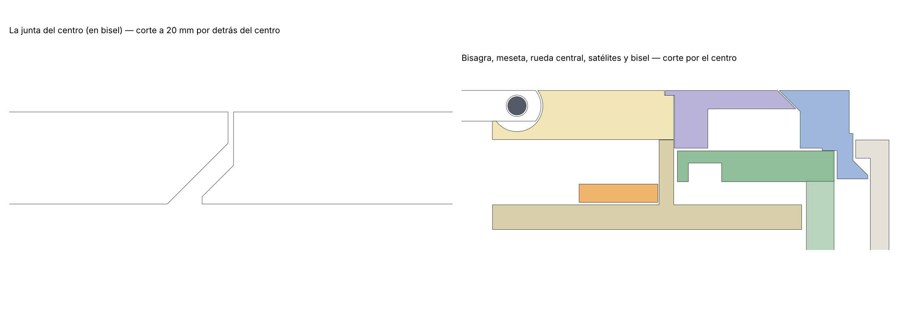

# Reporte: la caja v5 entera (puertas y ascensor)

Escrito el 21 de noviembre de 2026 por la sesión del PC. **Corregido el 24 de noviembre,** tras la revisión de la sesión del Mac ([`contra-reporte-caja.md`](contra-reporte-caja.md)): qué cambió, en el apartado 0.1. Responde al encargo del apartado 11 de [`../BRIEF-v5.md`](../BRIEF-v5.md).

**Nada de esto está impreso.** «Comprobado en el modelo» quiere decir que las piezas, dibujadas con sus holguras, se mueven como deben y no se pisan. No quiere decir que funcione: eso lo dirán las probetas. En este documento **no hay ninguna fuerza calculada** (tres previsiones de fuerzas ya las ha tumbado una pieza impresa).

Cada dato dice de dónde sale: **del modelo** (medido sobre las piezas dibujadas), **calculado** (cuenta hecha con medidas del modelo), **estimado**, **supuesto** (medida del reloj sin confirmar), **decidido** (lo eligió Pepe) o **medido** (sobre una pieza impresa).

## 0. En pocas líneas

- **Está modelada la caja entera: 23 piezas que se imprimen** (más la frase de la funda y el reloj de pega), en un programa de medidas y en Fusion. Las medidas del reloj van arriba de la lista, juntas.
- **Las puertas ya tienen cómo moverse**, que era lo que faltaba en el brief: un aro escondido alrededor del hueco gira 11° y mueve las dos a la vez. Lo abre y lo cierra la forma de las piezas, sin muelles, imanes ni gravedad.
- **En el modelo, de tope a tope y de 2 en 2 grados, ninguna pieza pisa a otra,** y el reloj de pega queda siempre a 3,00 mm o más de todo.
- **Mide 178,8 mm de lado y 120,7 de alto** (183,8 × 124,1 con la funda). Es más de lo que estimaba el brief (150). Ver el apartado 1.
- **Siete cosas no cumplen el brief al pie de la letra o las he cambiado.** Están en el apartado 1. Dos de ellas esperan una decisión tuya.
- **Propongo tres probetas** (puertas, ascensor y planetario). Sus ficheros de imprimir están en [`../probetas-v5/`](../probetas-v5/). Entre las tres son casi toda la caja: eso es una decisión tuya (apartado 9).

## 0.1 Qué cambió el 24 de noviembre

La sesión del Mac revisó el modelo y encontró 9 errores en las piezas, 1 en el programa y 6 en este reporte. Tenía razón. Su programa de comprobación, `calculos-mac/revisar_caja_v5.py`, daba 15 fallos; **ahora da 2, y los dos son decisiones tuyas** (filas 6 y 7 del apartado 1).

| Error | Qué pasaba | Qué he hecho |
| --- | --- | --- |
| E1 | Agujero de 0,3 × 1,2 mm en el centro de la raya | **Las dos puertas ya no son la misma pieza.** Una lleva la cuña a todo lo largo y la otra el hueco. Sin agujero |
| E2 | Los tetones de la plataforma, sin holgura en la rampa (0,02 mm) | La ranura se calcula ahora a través de la pendiente y con sus flancos curvos. Quedan 0,155 mm |
| E3 | Las puertas abiertas cedían hacia dentro hasta acercarse o tocar el reloj | Bisagras 1 mm más afuera, puerta abierta a 92° en vez de 90°, menos holgura en la bola (0,12) y en el aro (0,2). Empujada, cede hasta 87° y queda a 3,15 mm del reloj |
| E4 | Las puertas se rozaban al abrir y se pisaban si una se adelantaba | Con una cuña y un hueco enteros, y más hueco: lo más cerca, 0,31 mm; con 2° de adelanto no se pisan |
| E5 | El ala del bisel, una repisa en el aire | Es un cono a 45°: se imprime sin soportes |
| E6 | El aro: un extremo de cada pista en el aire y una pared de 0,3 mm | El anillo llega debajo de toda la pista; la pared mide 0,85 mm |
| E7 | La varilla tocaba el aro antes que la bola | Las paredes de la pista son 0,5 mm más bajas: ya no la toca |
| E8 | El cuerpo y la funda entraban girados | Cada uno tiene una llave escondida: girados no asientan |
| E9 | Zanjas delante y detrás del reloj cuando está arriba | **Sin arreglar.** Fila 6 del apartado 1 |
| Programa | Con otro reloj, la segunda parte decía «todo bien» aunque la primera fallara | La segunda repite las comprobaciones de la primera. Columnas, asiento y ejes de los satélites salen ya de parámetros. La junta antigua, quitada |
| Reporte | Orden de montaje imposible, «todas sin soportes», cifras | Corregido en los apartados 3, 5, 7 y 9 |

También: el cuerpo tiene ahora una ranura detrás para sacarlo, y los ficheros de imprimir salen del programa, con las mallas cerradas.

**El vídeo `../video-v5/` es del modelo del 21 de noviembre.** El mecanismo es el mismo; cambian detalles que no se aprecian (las puertas quedan 2° más abiertas). No lo he rehecho.

## 1. Lo que no cumple, o cambia, respecto al brief

Lo primero y sin adornar.

| # | Qué pedía el brief | Qué hay en el modelo | Por qué |
| --- | --- | --- | --- |
| 1 | Caja de unos 150 mm de lado y 135 de alto (estimado a mano) | **178,8 de lado y 120,7 de alto** (del modelo). Con funda, 183,8 × 124,1 | Alrededor del hueco de 50 × 59 van, uno dentro de otro: la meseta con las bisagras, la rueda central, los satélites, el bisel y la pared. La cuenta a mano del brief no contaba el sitio de las bisagras ni el del aro que mueve las puertas |
| 2 | Puertas cerradas: escalón de 0,3 mm o menos | **Cumple con la caja de pie** (apoyan en su asiento, a ras). **Boca abajo no:** cada puerta se puede descolgar hasta 2,5° (1,3 mm en la punta) antes de que la pare su pista (del modelo) | La bola que mueve cada puerta va en su pista con 0,12 mm de holgura por lado, y el brazo de la bola solo mide 8 mm: poca holgura ahí es mucho ángulo en la puerta. Se ajusta con la probeta (apartado 9) |
| 3 | Nueve imanes, tres en el final de recorrido | **Diez imanes,** cuatro en el final de recorrido (dos en la oreja del tubo y dos en el tope) | Con tres, uno tendría que servir para los dos extremos y quedaría a 4 mm de su pareja: no haría nada. Quedan 3 de repuesto de los 13 |
| 4 | Mejor nada pegado | **Los imanes de la funda y del soporte van en cajeras abiertas:** o entran a presión, o llevan un punto de pegamento. Los cuatro del tope entran de canto en una ranura y no se pueden caer con la caja boca abajo | No sé si un alojamiento de 5,20 sujeta el imán o solo lo deja entrar: la P0 dijo que «entra». Es adorno: sin imanes la caja funciona igual |
| 5 | Soporte del reloj: pinza en C y peana, como en la v4 | **Un soporte simplificado** (peana, dos mejillas y un travesaño que pasa por dentro del brazalete) | Sin las medidas del reloj no tiene sentido afinarlo. Sirve para comprobar que nada toca al reloj |
| 6 | Arriba, el pedestal rellena el hueco con 1 mm o menos de rendija por lado | **No.** A los lados quedan 1,9 mm hasta cada puerta. Delante y detrás queda a la vista una zanja de 7,7 mm de ancho y 5 de hondo | La zanja es el asiento donde apoyan las puertas cerradas, y en ella va la varilla que las mueve: para quitarla hay que rediseñar las puertas. Los 1,9 mm salen de separar las bisagras para que una puerta empujada no llegue al reloj. **Decides tú si importa** |
| 7 | Boca abajo no se cae nada | **El soporte con el reloj va suelto** (lo pide el brief): con la caja cerrada y boca abajo cae unos 3 mm, hasta apoyarse en las puertas; abierta, se sale | El brief pide las dos cosas a la vez. He bajado la caída de 5 a unos 3 mm, que es lo mínimo si el reloj tiene que estar a 3 mm de las puertas. Sujetarlo cambia cómo se coge el reloj: **decides tú** |

Y tres cosas que no son incumplimientos pero conviene que sepas:

- **La tarjeta no está modelada.** El brief la deja «en la funda, o fuera de la caja»: no tiene sitio todavía.
- **La frase está puesta en el techo de la funda,** de 118 mm de ancho. Ahí sale gratis: la funda se imprime boca abajo y la frase son sus tres primeras capas, en azul. Dónde va es tuyo (apartado 8).
- **La meseta (el marco liso que rodea las puertas) sale con otro acabado que las puertas.** Las puertas, la rueda central y el bisel se imprimen con la cara vista contra la cama; la meseta no puede (necesitaría soportes), así que su cara vista es la de arriba de la impresión. Puede notarse el brillo distinto. Ver el apartado 6.

## 2. Qué es y cómo funciona

### 2.1 De fuera adentro

- **Cuerpo:** la piel cuadrada. Lleva el índice del frente, en relieve. Entra a presión en la base con cuatro pestillos.
- **Bisel:** lo que se gira. Estriado por fuera y dentado por dentro (102 dientes). Asoma 8 mm sobre el cuerpo. No se puede sacar hacia arriba: un ala suya queda debajo del labio del cuerpo.
- **Satélites:** seis ruedas de 12 dientes, una azul. Ruedan entre el bisel y la rueda central, y al rodar dan vueltas alrededor del hueco.
- **Rueda central:** fija, 78 dientes. Por arriba es una placa lisa con seis dedos que tapan a medias los satélites: son los «puentes» del esqueleto.
- **Plato y tubo:** el plato lleva los ejes de los satélites y va encajado en lo alto del tubo. Giran juntos, a 0,567 veces lo que gira el bisel (calculado: 102 / 180).
- **Tubo:** por dentro lleva tres ranuras en espiral, como un pintalabios. En ellas van los tres tetones de la plataforma.
- **Plataforma con pedestal:** sube recta porque tres muescas suyas corren por las tres columnas de la base. Abajo del todo descansa en un asiento de la base, no colgada de sus tetones. Arriba del todo, el pedestal rellena el hueco de las puertas y queda a ras.
- **Marco y meseta:** lo fijo de arriba. El marco apoya en las tres columnas; la meseta va encima, lleva las bisagras y es lo liso que se ve alrededor de las puertas.
- **Puertas:** dos, de 5 mm. Son dos piezas distintas: una lleva la cuña de la junta y la otra, el hueco. Cada una gira en un pasador de 3 mm.
- **Aro de las puertas y tetón:** lo que las mueve. Apartado siguiente.
- **Funda:** campana cuadrada. Solo entra con su frente al frente (lleva un canal para el índice del cuerpo).

### 2.2 Cómo se mueven las puertas (lo que faltaba en el brief)

El brief proponía dos correderas con dos ranuras en espiral en el plato, y avisaba de que no sabía si cabían. Las dibujé: una corredera recta, al abrirse, se metía dentro del hueco libre de 50 × 59. Tampoco cabían dos franjas de espiral. Lo que hay es la tercera idea del brief (un aro intermedio que gira poco), resuelta así:

1. **Cada puerta lleva por debajo una varilla corta con una bola en la punta** (una manivela de 8 mm).
2. **Alrededor del hueco, escondido bajo la meseta, hay un aro** con dos pistas, una para cada bola. Cuando el aro gira 11°, las pistas empujan las bolas y las puertas giran 90°. Los dos extremos de cada pista son tramos «quietos» (arcos con centro en el eje de la caja): ahí el aro puede moverse un poco sin que la puerta se entere, y la puerta no puede moverse porque la bola está entre dos paredes. **Eso es lo que las bloquea abiertas y cerradas.**
3. **El aro lo mueve el plato con un tetón suelto** (un cilindro de 5 × 9 mm). El tetón está a la vez en tres ranuras: una espiral en la cara de abajo del plato, una ranura recta en el marco (solo le deja ir hacia dentro o hacia fuera) y una ranura en diagonal en un brazo del aro. Cuando el plato gira, la espiral mete el tetón 13 mm hacia dentro, y el tetón, al entrar, empuja la diagonal y gira el aro.

Así hay **una sola espiral** y no hay cruce de pistas: la trampa que avisaba el brief no puede darse.

**La junta del centro** es en bisel, a 45°: una puerta lleva una cuña a todo lo largo, que se mete 1,4 mm bajo la otra, y la otra lleva el hueco. Mirando desde arriba por la raya (0,3 mm) solo se ve puerta, sin agujero. Es en cuña, y no en escalón, para que las puertas se impriman con la cara vista contra la cama y sin soportes. El canto de la puerta del hueco se queda en 1,7 mm. Si al montar se cambian de lado, funciona igual.

### 2.3 El recorrido

| Giro del tubo | Giro del bisel | Qué pasa |
| --- | --- | --- |
| 0° a 45° | 0° a 79° | Tramo muerto: giran el bisel y los engranajes, nada más |
| 45° a 63° | 79° a 111° | El tetón empieza a entrar y el aro a girar, pero las bolas están en su tramo quieto: las puertas siguen cerradas |
| 63° a 83° | 111° a 146° | Las puertas se abren |
| 83° a 92° | 146° a 162° | Puertas ya de pie; el aro termina su giro y las deja bloqueadas |
| 92° a 335° | 162° a 591° | El reloj sube 86,1 mm |
| 335° a 345° | 591° a 609° | Rampa plana y tope: el reloj descansa arriba |

Todo el recorrido son **609° de bisel: una vuelta y dos tercios** (calculado). Se abre girando en el sentido de las agujas del reloj, visto desde arriba. Las puertas terminan de abrirse 9° de tubo antes de que el reloj empiece a subir.

## 3. Medidas

Todas del modelo, salvo donde se dice.

| Qué | Valor |
| --- | --- |
| Caja sin funda | 178,8 × 178,8 × 120,7 mm |
| Con la funda | 183,8 × 183,8 × 124,1 mm |
| Abierta, con las puertas de pie | sobresalen 28,1 mm la de la cuña y 26,3 la otra; el reloj de pega, 78 mm |
| Bisel | 167,2 mm de diámetro donde se agarra; asoma 8 mm; 120 estrías |
| Hueco de las puertas | 50 × 59 mm, libre del todo con las puertas abiertas |
| Puertas | 5 mm de grueso; raya del centro, 0,3 mm; holgura de la bisagra, 0,25 por lado; abiertas, a 92° |
| Recorrido del ascensor | 86,1 mm |
| Pendiente de la rampa | 14,7° donde apoyan los tetones (el brief estimaba 18°) |
| Lo que sube por vuelta de bisel | 72,3 mm (calculado) |
| Pedestal arriba | a ras (0,00); 0,4 mm hasta el marco. Con las puertas abiertas, 1,9 mm hasta cada puerta y una zanja delante y detrás (apartado 1, fila 6) |
| Engranajes | módulo 1,5; central 78 dientes, satélites 12, bisel 102; 6 mm de grueso |
| Juego entre dientes | 0,2 mm quitados a cada diente (parámetro `juego_dientes`) |
| Diente más fino | la punta del diente de los satélites: 0,81 mm. A media altura, 2,26 mm (medido por la revisión del Mac; el 21-nov di la mitad por error) |
| Reloj de pega a lo más cercano | 3,00 mm de la meseta y del marco; 3,00 de las puertas cerradas, que le quedan encima; 18,3 de la rueda central |
| Volumen de plástico si todo fuera macizo | 1.358 cm³ (unos 1,7 kg). Con relleno normal será bastante menos: **no está laminado, no lo sé** |

**Juego de la plataforma.** Va colgada de tres tetones en cono dentro de tres ranuras en V, que la centran por su peso. En la rampa, entre cada tetón y su ranura quedan 0,155 mm (medido con el programa de la revisión; el diseño pide 0,20 y el 21-nov, por un error mío, quedaban 0,02). En las columnas tiene 0,35 mm por lado: puede girar 0,29° a cada lado (calculado).

**Las medidas del reloj son todas supuestas** (cabeza 40 mm, 43,5 con corona, 11 de grueso; brazalete cerrado 67 × 53; alto en su soporte 78). Están arriba del todo en [`../caja_diseno_v5.py`](../caja_diseno_v5.py). El día que lo midas, se cambian ahí y se regenera todo.

## 4. Qué se ha comprobado y con qué

### 4.1 Con el programa, de 2 en 2 grados

[`../caja_piezas_v5.py`](../caja_piezas_v5.py) construye las 25 piezas en 3D, las coloca en 174 posiciones (de 0° a 345° de tubo, de 2 en 2) y calcula el volumen que comparte cada pareja de piezas. El resultado completo está en [`caja-fase2-comprobaciones.txt`](caja-fase2-comprobaciones.txt). No hay «ida y vuelta» distintas: en el modelo cada posición del bisel tiene una sola posición de todo lo demás, así que cerrar es pasar por las mismas 174 posiciones al revés.

| Qué | Resultado |
| --- | --- |
| Ninguna pieza pisa a otra | **Bien.** Ninguna pareja comparte más de 0,02 mm³ en ninguna posición |
| El reloj, a 3 mm o más de puertas, marco, meseta y rueda central | **Bien.** Mínimo, 3,00 mm |
| El tubo gira lo que le toca y los satélites orbitan | **Bien** por construcción (las piezas se colocan con la relación 0,567) y porque así colocadas los dientes no se pisan en ninguna posición |
| Puertas cerradas, bloqueadas | **Bien, con juego.** Con el aro quieto, una puerta se deja levantar 2,5° y ahí choca con su pista |
| Puertas abiertas, bloqueadas | **Bien, con juego.** Con el aro en su sitio, cada puerta se deja mover entre 89,75° y 94,5° (el brief pide entre 85° y 95°). Con el aro corrido 0,15 mm, cede hacia dentro hasta 87,0°, y ahí queda a 3,15 mm del reloj y entra 0,10 mm en el hueco libre (cifras del programa de la revisión) |
| Las puertas se pueden montar | **Bien.** Cada una entra de pie, desde arriba, con el aro en «abierto», sin pisar nada |
| El tetón va guiado | **Bien.** Moverlo 1,2 mm fuera de cualquiera de sus tres ranuras choca |
| La plataforma va guiada | **Bien.** No se deja subir, bajar ni girar por su cuenta |
| La plataforma no se hunde | **Bien.** Abajo apoya en su asiento (a 0,15 mm); en la rampa y arriba, bajarla 0,6 mm choca. Esto lo encontré tarde: sin el asiento, con la caja cerrada la plataforma bajaba 1 mm y al empezar a girar tenía que subir un escalón |
| Los dientes engranan | **Bien.** Girar un satélite medio diente lo mete en la rueda central y en el bisel |
| Topes | **Bien.** 2° más allá de cerrado o de abierto, la oreja del tubo choca con el tope de la base |
| Boca abajo no se cae nada de lo que va montado | **Bien** (el soporte con el reloj va suelto: fila 7 del apartado 1). Cada pieza, al moverla 1,5 mm hacia la tapa, choca con la que la sujeta. Lo que se descuelga: el bisel 0,8 mm, la rueda central 0,2 más, y las puertas lo dicho en el apartado 1 |
| Los pasadores no se salen | **Bien.** La rueda central les tapa las dos puntas |
| La funda | **Bien.** Puesta, no pisa nada y queda a 0,5 mm por lado |
| A ras | **Bien.** Puertas, meseta, placa de la rueda central y bisel, en un mismo plano; el pedestal, arriba, también |

### 4.2 En Fusion

[`../generador_caja_v5.py`](../generador_caja_v5.py) repite en Fusion, una a una, las mismas operaciones con que el programa hace cada pieza. Hecho de nuevo el 24 de noviembre con el modelo corregido. El resultado está en [`caja-fusion-comprobaciones.txt`](caja-fusion-comprobaciones.txt) y el modelo, en `../Eventually-caja-v5.f3d`.

| Qué | Resultado |
| --- | --- |
| Las piezas de Fusion son las del programa | **Bien.** Las 27 (25 de la caja y 2 de probeta) tienen el mismo volumen; la que más se aparta, 0,29 % (el programa redondea los cilindros). Fusion las construyó todas a la primera |
| Recorrido completo en Fusion: 174 posiciones, de 2 en 2 grados, cada pieza contra todas las que tiene cerca | **Bien.** Ninguna pareja se pisa. Con el modelo final, entero, de una vez. Tardó 40 minutos |

**Solo con el programa, no en Fusion:** la distancia del reloj a cada cosa, los juegos de las puertas, lo de boca abajo y los topes. Son las filas del apartado 4.1 y las del programa de la revisión (4.4).

**Los ficheros de imprimir ya no salen de Fusion,** sino del programa (apartado 9): los dos que el 21-nov tenían la malla sin cerrar (tubo y plataforma) ahora la tienen cerrada.

### 4.4 Con el programa de la revisión y capa a capa

- [`calculos-mac/revisar_caja_v5.py`](calculos-mac/revisar_caja_v5.py), de la sesión del Mac, hace las pruebas que el mío no hacía: holguras de imprimir, las piezas con sus juegos, capas sin apoyo, piezas giradas. **Daba 15 fallos; da 2,** los de las filas 6 y 7 del apartado 1.
- [`../caja_voladizos_v5.py`](../caja_voladizos_v5.py), mío y nuevo, mira capa a capa cuánto de cada pieza se imprimiría sin nada debajo. Resultado en [`caja-voladizos.txt`](caja-voladizos.txt). **Ninguna pieza tiene repisas en el aire. Sí hay techos en puente,** apoyados por los dos lados: los de las ventanas de la meseta (17 a 24 mm de luz, a 1 mm de la cama), la espiral del plato (5,4 mm), el final de cada ranura del tubo y los agujeros de los pasadores. Los puentes largos de la meseta pueden descolgarse: lo dirá la probeta.

### 4.3 Lo que no se puede comprobar en un modelo

- Si el bisel gira suave o duro.
- Si el reloj a medio subir se queda donde está al soltar el bisel. La rampa tiene 15°; el roce del plástico dirá.
- Si el aro, con roce de verdad, mueve las puertas sin engancharse. La pista tiene como mucho 28° de inclinación respecto al giro del aro: es suave, pero no está probado.
- Si se nota algún imán.

## 5. Lista de piezas

Todas caben en la X1 Carbon. Ninguna necesita soportes, pero varias tienen techos en puente (apartado 4.4). Capa de 0,2 mm, como las probetas anteriores.

| Pieza | Cuántas | Color | Mide (mm) | Cómo se imprime | Bandeja |
| --- | --- | --- | --- | --- | --- |
| Base con columnas | 1 | blanco | 179 × 179 × 101 | De pie, el fondo en la cama | 1 |
| Tubo | 1 | blanco | 161 de diámetro × 104 | De pie. Las ranuras son en V (45°) para salir sin soportes | 2 |
| Cuerpo | 1 | blanco | 179 × 179 × 109 | **Boca abajo:** el labio de arriba en la cama | 3 |
| Funda, con la frase | 1 | mármol y azul | 184 × 184 × 124 | **Boca abajo:** el techo en la cama. La frase son las tres primeras capas, en azul | 4 |
| Plataforma con pedestal | 1 | blanco | 151 × 154 × 30 | El disco en la cama, el pedestal hacia arriba | 5 |
| Bisel | 1 | blanco | 172 de diámetro × 14 | **Boca abajo:** la cara que se ve, en la cama | 6 |
| Plato | 1 | blanco | 161 de diámetro × 11 | La espiral hacia la cama, los ejes hacia arriba | 7 |
| Marco | 1 | blanco | 150 de diámetro × 22 | El ala en la cama | 8 |
| Satélites blancos | 5 | blanco | 21 de diámetro × 6 | Planos, todos con la misma cara abajo | 8 |
| Tetón | 1 | blanco | 5 de diámetro × 9 | De pie | 8 |
| Pasadores | 2 | blanco | 3 de diámetro × 90 | Tumbados | 8 |
| Soporte del reloj | 1 | blanco | 34 × 40 × 19 | La peana en la cama. Provisional | 8 |
| Rueda central | 1 | blanco | 149 × 133 × 9 | **Boca abajo:** la placa que se ve, en la cama | 9 |
| Puertas | 2, distintas | blanco | 39 × 73 × 11 | **Boca abajo:** la cara que se ve, en la cama; la manivela hacia arriba | 9 |
| Meseta | 1 | blanco | 108 de diámetro × 8 | De pie (la cara que se ve, arriba) | 10 |
| Aro de las puertas | 1 | blanco | 101 × 126 × 11 | El aro en la cama, las pistas hacia arriba | 10 |
| Satélite azul | 1 | azul | 21 de diámetro × 6 | Plano, la misma cara abajo que los otros | 11 |

**Material:** PLA en todo (estimado: es lo que se ha usado en las probetas). **Qué va encajado y qué a presión:** todo va apoyado o encajado por su forma; a presión, solo el cuerpo en la base (cuatro pestillos de 1 mm). **Pegado, nada**, salvo quizá los imanes de la funda y del soporte (apartado 1, fila 4).

**Imanes (10 de 5 × 1,6 mm, todos de adorno):** 2 en la oreja del tubo y 2 en el tope de la base («clac» al llegar a cada extremo); 2 en dos esquinas del cuerpo y 2 en la funda; 1 en el pedestal y 1 bajo el soporte. Los más cercanos a la cabeza del reloj son los del pedestal y el soporte, a unos 37 mm (calculado; el brief pide 30 o más). Siempre imán contra imán.

## 6. Qué es supuesto y qué puede fallar

De más a menos grave.

1. **Las medidas del reloj son supuestas.** De ellas sale el hueco, y del hueco, todo. Si el reloj es más ancho o más alto, la caja crece.
2. **El mecanismo de las puertas no se ha probado nunca.** Depende de una bola de 5 mm en una pista con 0,12 mm de holgura y de una varilla de 3 mm. Puede engancharse, tener demasiado juego o ser frágil. Es justo lo que no te convenció del iris («parece frágil»): **la probeta de las puertas es la primera que hay que imprimir.**
3. **El juego de las puertas** (2,5° cerradas). De pie no se nota porque apoyan; boca abajo, o si alguien mete la uña, sí. Remedio pensado y sin probar: desplazar la pista para que, cerrada, la bola quede apretada contra la pared que impide levantar la puerta (la varilla hace de muelle).
4. **Puertas abiertas que hacen palanca.** Sobresalen hasta 28,1 mm. Un empujón hacia fuera o hacia dentro lo para solo la bola contra la pared de su pista (2 mm de pared) y la varilla de 3 mm. No hay otro tope: dibujé uno fijo en la meseta y lo quité, porque con él la puerta no se podía montar. En el modelo, la pista hace tope; si aguanta un dedo, lo dirá la probeta.
5. **La rampa puede no sujetar el reloj a medio subir** (15°).
6. **Alturas que tienen que coincidir.** El bisel apoya en el plato y este en el tubo (106 mm de alto); la meseta apoya en el marco y este en las columnas (100 mm). Para que el bisel y la meseta queden a ras, las dos alturas impresas tienen que salir iguales. Un error de 0,2 mm en 100 es normal: puede quedar un escalón de ese orden entre el bisel y la placa de la rueda central.
7. **Los dientes de 12** son pequeños (punta de 0,44 mm). Los engranajes del iris no los había: no hay nada medido sobre dientes.
8. **El acabado distinto de la meseta** (apartado 1). Remedios: planchado de la última capa en el laminador, o aceptar la diferencia.
9. **El tubo roza con su canto de abajo en una pista de la base** y el plato lleva encima el bisel: todo el giro es plástico contra plástico. Puede ir duro.
10. **Imanes en cajeras abiertas** (apartado 1, fila 4).
11. **Muchas piezas:** 23, en unas 11 bandejas.
12. **Los diez riesgos que añade la revisión del Mac** ([`contra-reporte-caja.md`](contra-reporte-caja.md), apartado 5). Los que más: el engrane va justo (0,07 a 0,09 mm entre flancos) y al bisel no lo centra nada firme; el bisel tiene poca ventana en altura; el tetón suelto puede inclinarse. No los he tocado: los dirá la probeta.

## 7. Cómo se monta

En este orden. Entre paréntesis, qué impide montarlo mal.

1. **Plataforma** en la base, metiendo sus tres muescas en las tres columnas. (Las columnas no están repartidas por igual: 30°, 150° y 262°. Solo entra en una posición.)
2. **Tubo**, desde arriba, bajándolo por fuera de las columnas hasta que sus tres entradas pasan por los tres tetones de la plataforma. (Un tetón va 2° fuera de sitio: el tubo solo entra en una posición.)
3. **Marco** sobre las columnas. (Sus tres cajas, como las columnas, solo coinciden en una posición.)
4. **Aro de las puertas** sobre el marco, con su brazo en el hueco de atrás del cuello. (Solo cabe ahí.)
5. **Meseta** sobre el cuello del marco. (Entra de dos maneras, a media vuelta una de otra, y las dos son la misma: es simétrica.)
6. **Las dos puertas.** Con el aro girado a tope hacia «abierto» (se mueve con la mano, por su brazo), cada puerta se mete de pie, desde arriba, hasta que la bola entra en su pista. Está comprobado en el modelo que entra sin pisar nada. (Una puerta al revés queda con la varilla hacia arriba: se ve. Si se cambian de lado, funciona igual.)
7. **Los dos pasadores,** por un lado. Cosen la meseta, el marco y las puertas.
8. Se cierran las puertas girando el aro por su brazo, y se pone el **tetón** en la ranura del brazo del aro y en la del marco.
9. **Plato** sobre el tubo, con las puertas cerradas. (Tres almenas desiguales: una posición. Si el tubo o las puertas no están donde deben, la espiral no encuentra el tetón y el plato no asienta. Es el paso más a ciegas: el tetón tiene que estar en su sitio.)
10. **Los seis satélites** en sus ejes.
11. **Rueda central** sobre la meseta. (Tres llaves desiguales: una posición. Al bajar, tapa las puntas de los pasadores.) **Va después del plato y los satélites:** el 21-nov lo escribí al revés, y así no se puede montar.
12. **Bisel dentro del cuerpo** (entra por debajo), y los dos juntos, encima de todo. (Una llave escondida al frente: girado, el cuerpo no asienta.)
13. **Soporte y reloj** en el pedestal, y **funda**. (Un taco largo en una esquina: girada, la funda no asienta.)

Para desmontar, al revés: el cuerpo sale haciendo palanca con una uña o una moneda en la ranura que tiene detrás, abajo.

## 8. Lo que queda por decidir de la estética

Todo modelado con la opción más sencilla. Son tuyas:

| Qué | Cómo está ahora |
| --- | --- |
| Las cuatro esquinas de arriba, entre el bisel y el cuadrado | Lisas |
| Aristas del cuerpo | Vivas |
| Cuerpo liso o con estrías | Liso |
| Puentes | Seis dedos rectos de 8 mm de ancho, uno entre cada dos satélites |
| Algo grabado bajo la base | Nada |
| Frase escondida bajo el soporte | Nada |
| **Dónde va la frase de la funda** | En el techo, 118 mm de ancho. Es nuevo: no estaba en la lista del brief |
| **Cuánto se ven los satélites** | Una franja de 10 mm, entre la placa central y el bisel. Los dientes del bisel y de la rueda central quedan tapados |
| **La tarjeta** | Sin sitio |

No he hecho dibujos de alternativas: prefiero que elijas sobre la probeta o sobre este modelo.

## 9. Las probetas que propongo

Son trozos de la caja, sacados del modelo. Los ficheros están en [`../probetas-v5/`](../probetas-v5/), ya orientados. **Son los del modelo corregido el 24-nov** y los escribe [`../caja_probetas_v5.py`](../caja_probetas_v5.py) directamente, sin pasar por Fusion: todas las mallas son cerradas. No los he abierto en Bambu Studio.

**Una cosa que decides tú antes de imprimir.** La probeta del ascensor es la base, el tubo y la plataforma de verdad. La del planetario necesita debajo el tubo (de la del ascensor) y la meseta con el marco (de la de puertas). **Entre las tres son la caja entera menos el cuerpo, la funda y el soporte.** La decisión D-15 dice que no se imprime la caja completa sin medir antes el reloj. Si el reloj acaba midiendo lo supuesto, estas piezas valdrían como definitivas; si no, hay que repetirlas. Lo prudente es **imprimir primero solo la de puertas**, que es la que decide si este diseño te convence.

### Probeta 1: puertas

Marco, aro, meseta, dos puertas, dos pasadores y dos piezas que solo existen para la probeta: un **anillo** que hace de rueda central (tapa las puntas de los pasadores) y un **tetón con pomo** para mover el aro con el dedo. Dos bandejas:

- `caja-probeta-puertas-bandeja-A.3mf`: marco, las dos puertas, dos pasadores y el tetón con pomo (con el pomo en la cama).
- `caja-probeta-puertas-bandeja-B.3mf`: meseta, aro y anillo.

Vale si (la lista es la del brief, más dos líneas mías al final):

| Prueba | Vale si |
| --- | --- |
| Abrir y cerrar 20 veces, empujando el pomo | No se engancha |
| Abierta | Pasa un taco de 50 × 59 mm |
| Cerrada, pasando el dedo | No se nota escalón entre las puertas ni con la meseta |
| Cerrada, a contraluz | No se ve lo de dentro por la raya |
| Abierta, empujando una puerta con un dedo hacia dentro y hacia fuera | Ni se cierra ni cruje |
| Boca abajo, sujetando el anillo con los dedos, y sacudiendo un poco | No se cae nada. **Apunta cuánto se descuelgan las puertas** (el modelo dice hasta 1,3 mm cada una) |
| Montarla | No hay manera de montarla mal |
| Cerrada, intentando levantar una puerta con la uña | Apunta cuánto se deja |
| La varilla y la bola | No se han roto ni marcado después de las 20 veces |
| **Lo que decide** | **Si a ti te parece que cerrada se ve bien y que es sólida** |

Qué se ajusta y con qué: el juego de las puertas, con `bola_holgura` (0,12); la bisagra, con `holg_gira` (0,25); la raya, con `junta` (0,3).

### Probeta 2: ascensor

`caja-probeta-ascensor-base.3mf`, `caja-probeta-ascensor-tubo.3mf` y `caja-probeta-ascensor-plataforma.3mf`. Se gira el tubo con la mano.

| Prueba | Vale si |
| --- | --- |
| Subir y bajar 20 veces, con 150 g encima | No se engancha ni da saltos |
| A media altura, con 150 g, soltar el tubo | La plataforma no baja sola. **Si baja, no es un fallo de impresión:** hay que decidir entre menos pendiente (más vueltas de bisel) o un freno |
| Arriba y abajo | Hay tope y un tramo en que girar no sube ni baja |
| Mirando la plataforma al subir | No cabecea a la vista |
| El tubo | Solo entra en una posición |
| Los imanes del tope | Se nota o no (es adorno: apúntalo) |

Qué se ajusta y con qué: la pendiente, con `giro_arriba` y `giro_sube`; el juego, con `holg_desliza` (0,20).

### Probeta 3: planetario

`caja-probeta-planetario-plato.3mf`, `caja-probeta-planetario-rueda-central.3mf`, `caja-probeta-planetario-bisel.3mf` y `caja-probeta-planetario-satelites.3mf` (los seis, uno de los cuales habrá que poner en azul en el laminador, y el tetón normal, que hace falta para que el plato mueva las puertas). Se monta encima de las otras dos probetas. Sin el cuerpo, el bisel se puede levantar con la mano: es normal.

| Prueba | Vale si |
| --- | --- |
| Girar el bisel de tope a tope, cinco veces en cada sentido | Suave, sin puntos duros ni saltos de diente |
| Cambiar de sentido | El bisel no gira «en vacío» más de lo que te parezca aceptable. Apunta cuánto |
| Mirando los satélites | Orbitan, no se montan unos dientes en otros y no se levantan de sus ejes |
| Con las otras dos probetas debajo | Al girar el bisel pasa todo en su orden: nada, puertas, reloj |
| Los dientes, después | Ninguno roto ni mordido |

Qué se ajusta y con qué: el juego, con `juego_dientes` (0,2); si los dientes de 12 no salen, con `modulo` (1,5) y los números de dientes.

## 10. Ficheros

| Qué | Dónde |
| --- | --- |
| Las medidas, con las del reloj arriba | [`../caja_diseno_v5.py`](../caja_diseno_v5.py) |
| Las piezas y las comprobaciones | [`../caja_piezas_v5.py`](../caja_piezas_v5.py), que escribe `../caja-v5-piezas.json` |
| El generador de Fusion | [`../generador_caja_v5.py`](../generador_caja_v5.py) |
| El modelo de Fusion | `../Eventually-caja-v5.f3d` |
| Las comprobaciones | [`caja-fase1-comprobaciones.txt`](caja-fase1-comprobaciones.txt), [`caja-fase2-comprobaciones.txt`](caja-fase2-comprobaciones.txt) y [`caja-fusion-comprobaciones.txt`](caja-fusion-comprobaciones.txt) |
| Los dibujos | [`../caja_render_v5.py`](../caja_render_v5.py) y [`../caja_figuras_v5.py`](../caja_figuras_v5.py) |
| Las probetas | [`../probetas-v5/`](../probetas-v5/), escritas por [`../caja_probetas_v5.py`](../caja_probetas_v5.py) |
| Capas sin apoyo | [`../caja_voladizos_v5.py`](../caja_voladizos_v5.py) y [`caja-voladizos.txt`](caja-voladizos.txt) |
| La revisión de la sesión del Mac | [`contra-reporte-caja.md`](contra-reporte-caja.md) y [`calculos-mac/revisar_caja_v5.py`](calculos-mac/revisar_caja_v5.py) |

La nota [`antes-de-modelar-caja.md`](antes-de-modelar-caja.md) queda superada por este reporte: describía una corredera recta que no llegó al modelo.
