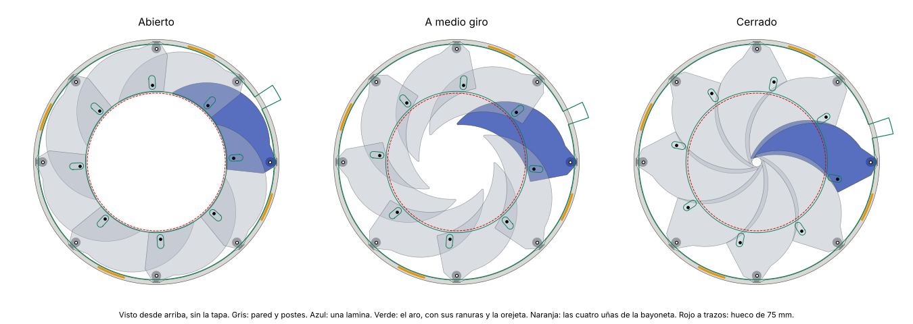
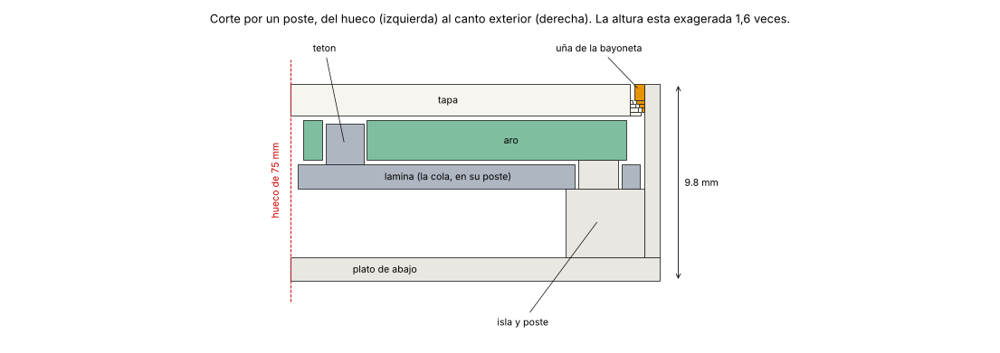
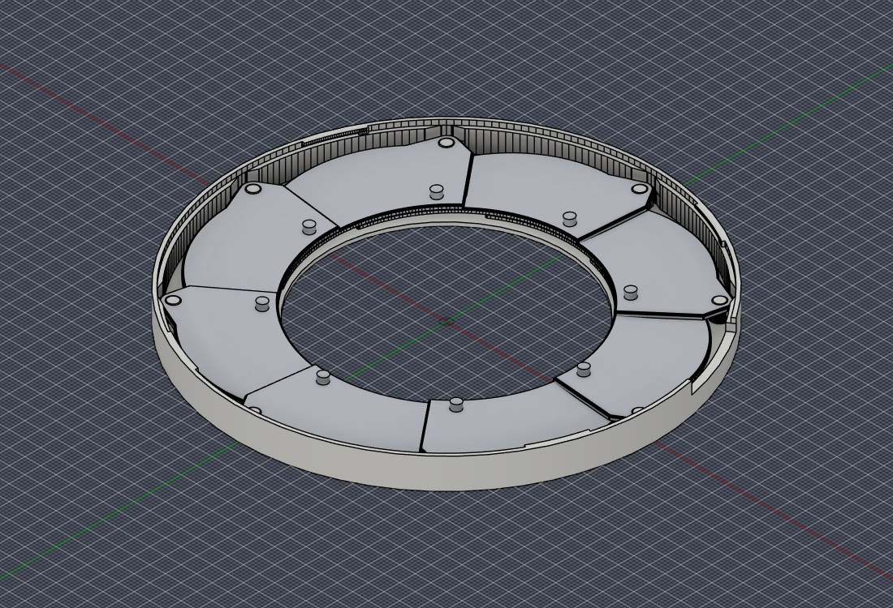

# Probeta 1: el iris. Reporte

Sesión del PC · 21 de noviembre de 2026 · responde al apartado 11 de [BRIEF-v5.md](../BRIEF-v5.md).
**Modelada y comprobada en el modelo. Sin imprimir.** «Sin choques en el modelo» no es «funciona»: lo dirá la pieza.

**Puesto al día el 21-nov a las 08:15:** añadido el tercer juego de láminas, de 0,4 mm (D-28), y corregida una cifra mía que estaba mal (apartado 4). La revisión de la sesión del Mac está en [contra-reporte-iris.md](contra-reporte-iris.md): **calcula que con las láminas de 1,2 y de 0,8 el iris no cerrará del todo.** La carcasa no ha cambiado.

## 1. Lo que mide (medido en el modelo de Fusion)

| Qué pide el brief | Valor | Sale | ¿Cumple? |
| --- | --- | --- | --- |
| Diámetro exterior | 130 mm o menos | **133,5 mm** | **No, por 3,5 mm.** Ver el apartado 2 |
| Hueco libre, abierto | 75 mm o más | Pasa un cilindro de **75,0 mm** sin tocar nada. Las láminas quedan escondidas hasta 76,0 | Sí |
| Agujero central, cerrado | 8 mm o menos | **4,8 mm** en la posición nominal y **3,4 mm** apretando hasta el tope | Sí |
| Giro del aro | 60° o menos | **16,1°** de tope a tope | Sí |
| Grueso total | 10 mm o menos | **9,8 mm** | Sí |
| Láminas | 6 a 8, de 1,2 mm o más | 8. Tres juegos: de 1,2 mm, de 0,8 (D-23) y de 0,4 (D-28) | Sí el de 1,2 |
| Sin pegamento ni tornillos | | La tapa cierra con bayoneta de cuatro uñas | Sí |
| Boca abajo no se cae nada | | La lámina solo puede bajar 0,2 mm hasta el aro, y el aro 0,2 mm hasta la tapa | Sí, en el modelo |

Además: la orejeta sale 9,0 mm de la pared (142,5 mm de la punta al lado contrario). Cada lámina gira 33,4°. Peso en PLA macizo: unos 88 g con las láminas de 1,2.

Las 28 comprobaciones de Fusion están en [`../probetas-v5/comprobaciones-fusion.txt`](../probetas-v5/comprobaciones-fusion.txt) y las 32 del cálculo en plano, grado a grado, en [`comprobaciones-plano.txt`](comprobaciones-plano.txt). Fallan cero, quitando el diámetro.

## 2. Lo que no se cumple: el diámetro

**Le dije a Pepe que con 8 láminas salían 125 a 127 mm (D-23). Estaba mal: salen 133,5.** Aquel cálculo no contaba dónde va el eje de cada lámina ni cómo se sujeta la tapa. Al dibujarlo de verdad:

- El eje de una lámina no puede ir debajo de otra lámina. Tiene que estar fuera de la zona donde se cruzan: a 61,9 mm del centro.
- Detrás del eje hace falta la cola de la lámina (3,3 mm), su holgura (0,35) y una pared (1,2).

Formas de bajar de 130, **ninguna comprobada**:

| Cambio | Diámetro estimado | Qué cuesta |
| --- | --- | --- |
| Dejarlo así | 133,5 mm | La caja entera sale unos 4 mm más ancha |
| Pared y escalón de 1,0 mm en vez de 1,2 | unos 132,7 | Pared más frágil. Poco |
| 10 láminas en vez de 8 | unos 126 (calculado con un modelo anterior, más simple) | Dos láminas más, más finas. Hay que rehacer el cálculo |
| Hueco de 72 mm en vez de 75 | unos 3 a 5 mm menos | Depende de las medidas del reloj, que siguen sin tomarse |

**Decidido por Pepe el 21-nov (D-27): se imprime así, y el resto de la caja se adapta a 133,5 mm.** La probeta sirve para saber si un iris de PLA abre y cierra suave, y eso no depende de 3,5 mm.

## 3. Cómo es por dentro

- **Base:** plato de abajo y pared, en una pieza. Junto a la pared hay 8 islas con un poste de 3,2 mm.
- **Láminas:** cada una tiene un agujero en la cola, que entra en su poste, y un tetón hacia arriba. Se apilan en escalera: la raíz de cada una va encima de las dos anteriores.
- **Aro (azul en Fusion):** va encima de las láminas, apoyado en los postes. Tiene 8 ranuras, una por tetón. Al girarlo, las ranuras empujan los tetones y las láminas giran.
- **Orejeta:** sale por un hueco de la pared. Los dos extremos del hueco son los topes de abierto y cerrado.
- **Tapa:** entra por arriba y se gira 13° hasta un tope. Cuatro uñas de la pared la sujetan.

## 4. Qué es supuesto

| Supuesto | Valor | Por qué importa |
| --- | --- | --- |
| Hueco libre | 75 mm | Estimado en el brief. El reloj no está medido |
| Holgura de los ejes y de los tetones | 0,25 mm por lado | En la P0, 0,10 sujetaba y 0,15 pasaba. Aquí tiene que girar suelto. Sin probar a capa de 0,2 |
| Holgura del aro y de la tapa con la pared | 0,25 y 0,3 mm | Sin probar |
| **Las láminas tienen que ceder al cerrar** | Colocadas rígidas, al cerrar se pisarían 1,13 mm las de 1,2, 0,73 las de 0,8 y 0,33 las de 0,4 | **Es lo que más puede fallar.** Ocho láminas planas no pueden montar una sobre otra en rueda sin deformarse. ~~Dije que bastaban unos 11 gramos por lámina.~~ **Esa cifra estaba mal:** traté la lámina como una regla que se dobla por la punta, y lo que tiene que hacer es retorcerse en la punta, que es mucho más duro. La cuenta buena es la de la sesión del Mac: se pondrá duro con el agujero a 30-40 mm (1,2), a 15-20 mm (0,8) y cerraría con 0,4. He repetido su estimación por otro camino y me sale el mismo orden: 100 a 250 gramos entre láminas de 1,2, y unas 80 veces menos con las de 0,4. Estimado: lo dirá la pieza |
| Las uñas de la tapa | Vuelan 0,8 mm en rampa de 45° y pisan 0,5 mm de tapa | Tienen que salir sin soportes. La tapa no tiene retén: se queda por rozamiento |
| Holgura acumulada | Hasta 1,6 mm de retraso en la punta de la lámina | Por eso el agujero cerrado real saldrá entre 3,6 y 6,8 mm, no 4,8 justos |

## 5. Imprimir

PLA blanco, capa de 0,2 mm, sin soportes, pared Aracne. Ya están orientadas: se abren y se imprimen tal cual.

| Fichero (`caja/probetas-v5/`) | Qué es | Bandeja |
| --- | --- | --- |
| `iris-base.3mf` | Plato de abajo con la pared | 134 × 134 mm |
| `iris-aro.3mf` | Aro con la orejeta | 132 × 128 mm |
| `iris-tapa.3mf` | Tapa | 131 × 131 mm |
| `iris-laminas-1.2mm-x8.3mf` | Las 8 láminas de 1,2 | 133 × 141 mm |
| `iris-laminas-0.8mm-x8.3mf` | Las 8 láminas de 0,8 | 133 × 141 mm |
| `iris-laminas-0.4mm-x8.3mf` | Las 8 láminas de 0,4 (D-28) | 133 × 141 mm |
| `iris-lamina-1.2mm-suelta.3mf`, `iris-lamina-0.8mm-suelta.3mf`, `iris-lamina-0.4mm-suelta.3mf` | Una lámina, por si se rompe alguna | |

Son seis bandejas: en la X1 Carbon no caben dos discos de 133 mm a la vez. Las cinco primeras no han cambiado desde el 21-nov a la 01:00.

**Las láminas de 0,4 mm** son una hoja de dos capas. Para que encajen en la misma carcasa:

- La cola está engordada a 1,2 mm, como en las de 0,8: ajusta igual entre la isla y el aro.
- El tetón no nace de la hoja, sino de un **refuerzo redondo de 6 mm de diámetro y 1,2 de grueso**. Un tetón de 3 mm sobre dos capas se arrancaría. El refuerzo no lo pedía el encargo: lo he añadido yo. Está en una zona por donde no pasa ninguna lámina por encima (la más cercana, a 21,8 mm).
- El rebaje del canto es de una sola capa (0,2 mm hacia dentro).
- Son frágiles: despegarlas de la cama con cuidado y en frío.

## 6. Montar

Todo visto desde arriba.

1. La base sobre la mesa.
2. Las láminas (primero un juego; luego se cambia por otro), una a una: el agujero en su poste y el tetón hacia arriba. El cuerpo sale del poste **en sentido contrario a las agujas del reloj**, pegado a la pared, como en el dibujo de «Abierto». Se colocan seguidas, avanzando en ese mismo sentido. Cada una monta sobre la anterior.
3. Las dos últimas: su punta tiene que quedar **debajo** de las dos primeras. Se levantan un poco las primeras y se mete.
4. El aro: las 8 ranuras en los 8 tetones y la orejeta en el hueco de la pared.
5. La tapa, con la cara que tocó la cama hacia abajo: sus cuatro rebajes sobre las cuatro uñas, se deja caer y se gira **en el sentido de las agujas del reloj** hasta el tope.
6. Para cerrar el iris, la orejeta se mueve en el sentido de las agujas del reloj.

## 7. Vale si

| Prueba | Vale si | Resultado de Pepe |
| --- | --- | --- |
| Abrir y cerrar 20 veces con un dedo en la orejeta | No se engancha ninguna vez | |
| Abierta, meter un cilindro de 75 mm | Pasa | |
| Cerrada, mirar a contraluz | No se ve lo de dentro, salvo el agujero central | |
| Boca abajo y sacudir un poco | No se desmonta ni se cae ninguna lámina | |

Y para apuntar, aunque valga:

- Cuánto mide el agujero central cerrado.
- Si se engancha, en qué punto del giro y si es al abrir o al cerrar.
- Si la tapa entra, si gira hasta el tope y si se queda puesta.
- Si las uñas han salido limpias.
- Repetir todo con las láminas de 0,8 y con las de 0,4, y decir cuál va más suave.
- **Sin forzar** (lo pide la revisión del Mac): cerrar hasta que se ponga duro y apuntar cuánto mide el agujero en ese punto, con cada juego. Antes de empezar, una raya de lápiz que cruce de la tapa a la pared, para ver si la tapa se mueve.
- El diámetro exterior real.

## 8. Cómo se rehace

Las medidas están en la lista `P_DEF` de [`../iris_diseno_v5.py`](../iris_diseno_v5.py), cada una con su comentario. Ese programa no necesita Fusion: calcula las formas, hace las comprobaciones grado a grado y escribe `iris-v5.json`. Después, [`../generador_iris_v5.py`](../generador_iris_v5.py) se ejecuta dentro de Fusion, lee ese fichero, construye las piezas, las mide y exporta los `.3mf`. Las figuras de este reporte salen de `../iris_figuras_v5.py`. El modelo montado está en `../Eventually-iris-v5.f3d`.
